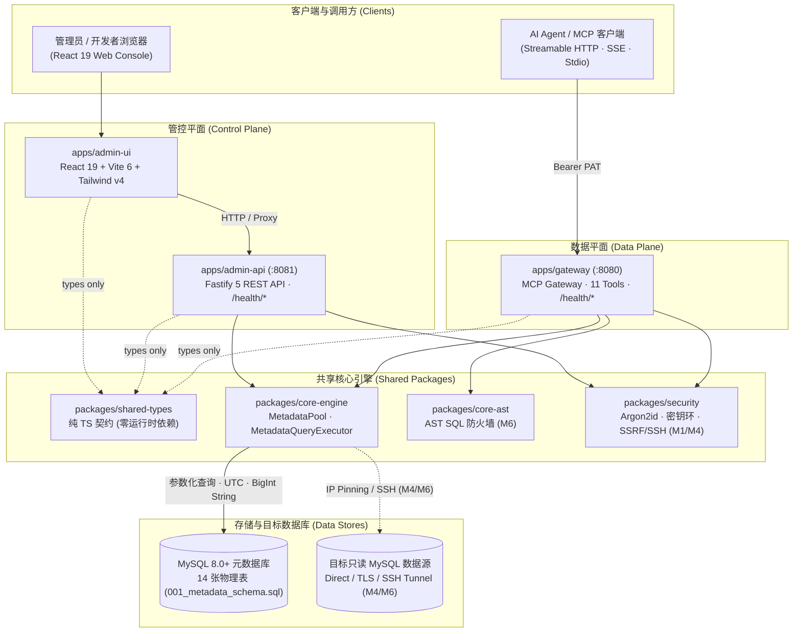

# MySQL MCP

<div align="center">

**零信任 MySQL MCP 网关与企业级 Web 管控平台**  
*双平面解耦架构 · 只读 AST SQL 防火墙 · 角色/库表 ACL 策略矩阵 · 双重漏斗限流 · SSRF/SSH 安全通道 · 全链路脱敏审计*

[](./package.json)
[](./.nvmrc)
[](./package.json)
[](./tsconfig.base.json)
[](./package.json)
[](./apps/admin-ui/package.json)
[](./docs/sql/001_metadata_schema.sql)

[系统概述](#系统概述) · [系统架构](#系统架构) · [快速开始](#快速开始) · [技术栈](#技术栈) · [目录结构](#目录结构) · [质量门禁](#质量门禁与工程规范) · [设计文档](#官方设计与技术文档) · [路线图](#路线图-roadmap)

</div>

---

## 系统概述

> **当前里程碑状态（`v0.1.0` / M0 工程底座阶段）**：本仓库正在按 `M0 -> M7` 垂直切片推进。当前已落地 **M0 双端工程底座、Git/CI 安全护栏、14 张元数据物理表基线、健康探针及开发态 `/_lab` 组件实验室**；`M1 ~ M7` 的业务接口、鉴权、数据源管理与 MCP 11 项工具将在后续里程碑陆续交付，演示截图与生产部署指南随业务模块完备后补充。

**MySQL MCP** 是一个面向 AI Agent 与研发团队的**零信任只读 MySQL MCP 网关与管控平台**，采用数据平面与管控平面分离架构：

- **数据平面网关 (`apps/gateway`, Port `8080`)**：面向 AI 客户端（Claude Desktop / Cursor / Windsurf 等），规划提供 Streamable HTTP / Legacy SSE / Stdio 传输、11 项只读 MCP 工具、AST SQL 语法防火墙、库表黑名单优先于白名单的 ACL 引擎、双重漏斗限流（User + Profile）及高危审计微批落盘。
- **管控平面 API (`apps/admin-api`, Port `8081`)**：提供 `/api/v1/*` 47 项企业级管控接口（系统自举、Cookie/CSRF 会话、PAT 个人访问令牌、审批工单、用户全生命周期、数据源 Profile 密钥环加密与 SSRF/SSH 三模式连通性测试、ACL 与限流治理、审计排查与通知）。
- **Web 管控控制台 (`apps/admin-ui`)**：基于 React 19 + Vite 6 + Tailwind CSS v4 + OKLCH 双模式令牌 + shadcn/ui 构建的高密度（8/10）运维界面，锁定 `56px` 顶栏、`240px / 64px` 侧边栏与 `38px` 表格行高，全站零 Emoji 并满足 WCAG 2.1 AA 对比度。

---

## 系统架构



---

## 快速开始

### 1. 环境准备（严格锁定工具链）

- **Node.js**：`22.22.0`（见 [`.nvmrc`](./.nvmrc)）
- **pnpm**：`10.32.1`（见 [`package.json`](./package.json) `packageManager`）
- **Python**：`3.11+`（用于契约防漂移与数据库设计静态校验）
- **Docker**：Docker Desktop / Engine（用于拉起本地 `mysql:8.0` 元数据库）

### 2. 安装依赖与初始化本地元数据库

```bash
# 1. 安装依赖（自动激活 Husky commitlint 钩子）
pnpm install --frozen-lockfile

# 2. 启动本地 Docker MySQL 8.0 并导入 14 张元数据物理表（docs/sql/001_metadata_schema.sql）
# 可选通过 shell 环境变量或本地被 .gitignore 忽略的 .env 指定 MYSQL_ROOT_PASSWORD / METADATA_DB_USER / METADATA_DB_PASSWORD
node scripts/m0/mysql-up.mjs
```

### 3. 启动本地服务与开发态组件实验室 (`/_lab`)

```bash
# 1. 编译后端与核心包
pnpm build

# 2. 启动管控面宿主（默认监听 127.0.0.1:8081，提供 /health/live 与 /health/ready）
pnpm --filter @mysql-mcp/admin-api start

# 3. 启动网关宿主（默认监听 127.0.0.1:8080，提供 /health/live 与 /health/ready）
pnpm --filter @mysql-mcp/gateway start

# 4. 启动前端开发服务器（支持 /health 与 /api 代理至 127.0.0.1:8081）
pnpm --filter @mysql-mcp/admin-ui dev
```

访问入口（开发态）：
- **基座状态页**：`http://127.0.0.1:5173/`（实时探测 `admin-api:8081` 健康状态）
- **组件实验室 (`/_lab`)**：`http://127.0.0.1:5173/_lab`（仅 `import.meta.env.DEV` 挂载，生产构建自动裁除）

> 停止本地 Docker MySQL：`docker compose down`（保留数据卷）或 `docker compose down --volumes`（清空重建）。

---

## 技术栈

| 层级 | 技术选型（锁定版本） | 说明 |
| :--- | :--- | :--- |
| **运行时与语言** | `Node.js 22.22.0` · `TypeScript 5.9.3` (`strict`) | 全链路 `EntityId = string`，禁止 `as any` / `@ts-ignore` |
| **Web 与网关框架** | `Fastify 5.12.8` | 管控面 REST API（8081）与 MCP 网关（8080） |
| **数据库与安全** | `mysql2 3.24.6` · `node-sql-parser 5.4.0` · `@node-rs/argon2 2.0.2` · `ssh2 1.16.0` | 精确锁版禁止 `^`/`~`；`MetadataPool` 强制 UTC 与 `bigNumberStrings` |
| **前端架构** | `React 19` · `Vite 6` · `Tailwind CSS v4 (@theme)` · `shadcn/ui` · `Lucide Icons` | OKLCH Dark/Light 双模式（WCAG 2.1 AA），原生 `<dialog>` 与 `inert` 防穿透 |
| **工程与安全治理** | `pnpm 10.32.1` · `ESLint 9` · `Husky 9` · `commitlint` · `Playwright` · `CodeQL` | 单向依赖边界护栏、契约防漂移校验、包体 gzip 预算与 SAST 扫描 |

---

## 目录结构

```text
mysql-mcp/
├── apps/
│   ├── gateway/             # MCP 数据面网关（Port 8080）
│   ├── admin-api/           # 管控面 REST API（Port 8081）
│   └── admin-ui/            # React 19 Web 控制台与开发态 /_lab 组件实验室
├── packages/
│   ├── shared-types/        # 纯 TS 契约类型（零运行时依赖、零运行时 JS）
│   ├── core-engine/         # MetadataPool、MetadataQueryExecutor 与数据面连接池
│   ├── core-ast/            # 只读 AST SQL 防火墙与 LIMIT 改写引擎（M6）
│   └── security/            # 密钥环加密、Argon2id、SSRF IP Pinning 与 SSH 隧道（M1/M4）
├── docs/
│   ├── sql/                 # 唯一物理表基线 001_metadata_schema.sql（14 张表）
│   ├── contracts/           # 47 项接口追踪、契约类型与请求字段基线
│   └── *.md                 # 架构、前后端详设、接口契约、数据库与视觉规范
├── scripts/                 # 设计分片、合成校验脚本与 M0 门禁脚本
├── tests/                   # 后端单测、机械护栏测试与真实 MySQL 集成测试
├── todos/                   # M0 ~ M7 模块垂直切片交付清单
├── AGENTS.md                # AI 与研发工程宪章（红线与 SSOT 优先级）
├── TODO.md                  # 双端垂直切片总索引
└── compose.yaml             # 本地 Docker MySQL 8.0 元数据库编排
```

---

## 质量门禁与工程规范

本地开发与 PR 合入均须通过以下机械护栏与真实环境验证：

```bash
# 类型检查、ESLint 与 Monorepo 单向依赖边界校验
pnpm typecheck
pnpm lint

# 契约与数据库设计防漂移校验
python scripts/generate_readiness_contracts.py --check
python scripts/validate_database_design.py

# 单元测试与 15 项机械护栏回归
pnpm test
pnpm test:guardrails

# 真实 Docker MySQL 8.0 集成验收（14 表 + PENDING + 双端 HTTP 探针）
node scripts/m0/mysql-up.mjs
pnpm test:integration

# 前端生产构建、gzip 包体预算（vendors <= 140KB / core <= 40KB / dynamic <= 60KB）与真实后端 Playwright E2E
pnpm ci:frontend --require-frontend

# 高危依赖漏洞审计
pnpm audit --audit-level=high
```

---

## 官方设计与技术文档

| 文档 | 说明 |
| :--- | :--- |
| [工程宪章 (`AGENTS.md`)](./AGENTS.md) | 锁定技术栈、SSOT 优先级、红线约束与 Git/CI 规范 |
| [里程碑总索引 (`TODO.md`)](./TODO.md) | `M0 ~ M7` 双端垂直切片路由与分段勾选口径 |
| [物理建表基线 (`docs/sql/001_metadata_schema.sql`)](./docs/sql/001_metadata_schema.sql) | 14 张元数据物理表、索引、外键与自举状态基线 |
| [接口契约规范 (`docs/API_CONTRACT_SPEC.md`)](./docs/API_CONTRACT_SPEC.md) | 47 项管控面 REST 接口签名、错误码与追踪基线 |
| [总体架构设计 (`docs/ARCHITECTURE_SPEC.md`)](./docs/ARCHITECTURE_SPEC.md) | 双平面运行机制、零信任安全模型与核心数据流 |
| [后端架构详设 (`docs/BACKEND_ARCHITECTURE_SPEC.md`)](./docs/BACKEND_ARCHITECTURE_SPEC.md) | 状态机、并发锁序、限流与连接池安全通道详设 |
| [前端架构详设 (`docs/FRONTEND_ARCHITECTURE_SPEC.md`)](./docs/FRONTEND_ARCHITECTURE_SPEC.md) | 守卫链、DTO 映射、OKLCH 令牌与布局范式 |
| [数据库设计规范 (`docs/DATABASE_DESIGN_SPEC.md`)](./docs/DATABASE_DESIGN_SPEC.md) | 实体关系、约束校验与 `RD-08` 未决决策追踪 |
| [视觉与布局规范 (`docs/UI_DESIGN_SPEC.md` / `docs/LAYOUT_SPEC.md`)](./docs/UI_DESIGN_SPEC.md) | 视觉密度、信息层级与响应式断点基线 |

---

## 路线图 (Roadmap)

详细子任务与验收状态见 [`TODO.md`](./TODO.md) 及 [`todos/`](./todos/)：

- [ ] **M0**：双端工程底座、Git/CI 安全护栏、Docker 14 表与 `/_lab` 组件实验室（Step 1~3 本地 QA 全绿，正在完成 GitHub 远端首轮 CI / CodeQL 门禁闭环）
- [ ] **M1**：系统自举、认证会话、Cookie/CSRF 与四级路由守卫闭环（9 接口 · 6 视图）
- [ ] **M2**：开发者个人中心、PAT 单次展示三态弹窗与客户端配置生成（4 接口 · 2 视图）
- [ ] **M3**：审批工单中心与用户全生命周期（超管防自残与并发锁序，8 接口 · 2 视图）
- [ ] **M4**：数据源 Profile CRUD、密钥环加密与 SSRF/SSH 三模式连通性测试（6 接口 · 1 视图）
- [ ] **M5**：角色/库表 ACL 策略矩阵与双重漏斗限流（13 接口 · 2 视图）
- [ ] **M6**：MCP 数据面核心引擎（AST 防火墙、连接池、11 项 MCP 工具、审计微批）
- [ ] **M7**：全链路审计排查抽屉、CSV 导出、通知与 Bento 大盘收口（7 接口 · 3 视图）
