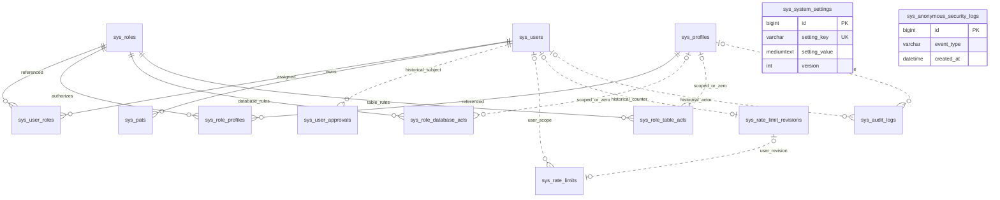

# MySQL MCP 企业级网关与管控平台 — 数据库设计说明书

| 项目 | 内容 |
| :--- | :--- |
| 文档版本 | v1.0.2 |
| 编制日期 | 2026-11-11；修订日期 2026-11-12 |
| 状态 | 数据库详细设计评审稿；DDL 已做静态校验，尚未在真实 MySQL 上执行验收 |
| 适用范围 | 单节点、单主进程 v1.0；元数据库建模、Repository 实现、接口联调、迁移与运维 |
| 技术基线 | MySQL 8.0、InnoDB、utf8mb4；本设计的 CHECK 约束要求 8.0.16 或更高小版本 |
| 配套文件 | `docs/sql/001_metadata_schema.sql`；`scripts/validate_database_design.py` |
| 密级 | 内部公开；示例不得包含真实凭据 |

> 本文设计的是网关自身的**系统元数据库**，不是被纳管 MySQL 实例的业务数据库。不在业务库创建 `sys_*` 表，不复制查询结果，不改变只读访问边界。文中的“新增设计”是对既有文档缺口的落地补充，不表示源文档已完成同步或系统已经实现。

## 开发准入整改（v1.0.2 / 2026-11-12）

核验并修订 RD-01/02/03/04/05/06/07/09：持久限流版本、UTC连接、单一DDL、读写DTO、请求字段、47项接口追踪、超管锁序与首次自举标记。
RD-08 产品/接口签署仍待确认；新库burst暂按数据库既有值10，库级ACL按既有v1.0精确名，不代表新增产品批准。
验证范围及未完成的真实MySQL/HTTP/浏览器门禁见 `docs/reviews/COMPREHENSIVE_DESIGN_READINESS_REMEDIATION_20261112.md`。

## 目录

1. 设计依据、优先级与差异收口
2. 数据边界与设计原则
3. 概念模型与关系约束
4. 物理设计规范
5. 全量数据字典
6. JSON 配置、枚举与 API 映射
7. 事务、并发与权限失效
8. 索引、检索与统计
9. 审计持久化、重放与分区
10. 安全、密钥与数据库权限
11. 初始化与数据迁移
12. 容量、保留与备份恢复
13. 接口及前端需求追踪
14. 验收测试与交付边界
15. 待确认事项与参考资料

---

## 1. 设计依据、优先级与差异收口

### 1.1 输入基线

| 编号 | 依据 | 版本 / 日期 | 本文重点依赖章节 |
| :--- | :--- | :--- | :--- |
| S1 | `docs/ARCHITECTURE_SPEC.md` 系统架构 | v1.2.1 / 2026-11-07 | §3 单节点拓扑；§4.2/4.8/4.9 认证、审计与防自锁；§5 元数据模型；§8 部署与验收 |
| S2 | `docs/BACKEND_ARCHITECTURE_SPEC.md` 后端详细设计 | v1.7.1 / 2026-11-12 | §4 DDL/DAL；§5 账号及会话；§6 快照与失效；§8 连接池；§9.2/9.3 测试及密钥；§10 审计 |
| S3 | `docs/FRONTEND_ARCHITECTURE_SPEC.md` 前端详细设计 | v1.4.1 / 2026-11-12 | §3.3 大整型；§4 状态机；§5.2/5.3 大盘与审计；§8 DTO 与协同清单 |
| S4 | `docs/API_CONTRACT_SPEC.md` 接口契约 | v1.5.1 / 2026-11-12 | §2 类型/UTC/分页；§4 密码生命周期；§5 CAS；§6 全量接口，尤其 §6.7 代际与 §6.8 审计 |

编制时以工作区现有文档正文为依据，不以旧生成器片段覆盖成稿。实现时：**外部字段、错误码、状态转换与可见性以 S4 为准；内部执行边界以 S2 为准；S1 定义系统边界；S3 用于验证页面需求完整性。** 同一文档的规范性条款优先于示意 SQL/JSON。冲突不能通过静默修改 API 来解决。

### 1.2 差异与落地决策

| 编号 | 发现的差异 / 缺口 | 本设计采用的口径 | 性质 / 需同步对象 |
| :--- | :--- | :--- | :--- |
| DB-D01 | S2 §4 仅 13 张表；S4 §6.7 要求持久计数器，但未给完整 DDL | 增加 `sys_rate_limit_revisions`；规则表增加 `revision`，共 14 张业务元数据表 | 契约补齐；S2 Repository |
| DB-D02 | S4 更新覆盖只递增业务 revision，示例未同步持久计数器 | **创建和每次更新**均在同事务递增计数器；删除只删业务行。否则“创建1→更新2→删除→重建2”仍会 ABA | 新增闭环；S4 §6.7.4 示例需修正 |
| DB-D03 | S2 使用 `qpm_limit`，S4 某段 SQL 使用 `user_quota_qpm` | 物理列保留 `qpm_limit`；API `userQuotaQpm/defaultUserQuotaQpm` 由 Mapper 映射 | 不增加同义物理列 |
| DB-D04 | S2 metadata-pool 示例使用 `+08:00`；S4 要求 UTC 且毫秒 | 物理时间统一 `DATETIME(3)` UTC；服务端连接和驱动均 UTC；存量时区单独核查 | S2 §4.2 需同步 |
| DB-D05 | S2 环境注释是 `STAGING`；S4 写入枚举是 `STG` | 存储与 API 均为 `PROD/STG/DEV`；迁移显式转换 `STAGING` | 字段值收敛 |
| DB-D06 | S2 TLS JSON 注释 `ca/rejectUnauthorized` 与 S4 `enabled/ca_cert` 不同 | 持久化使用 S4 结构；驱动严格验真策略不得作为可关闭的用户字段 | S2 驱动映射需同步 |
| DB-D07 | S2 用户角色外键删除角色时 CASCADE；S4 禁止删仍被用户绑定的角色 | 改为 `fk_ur_role ... ON DELETE RESTRICT`；用户方向保持 CASCADE | 数据库兜底与 API 一致 |
| DB-D08 | S4 删除用户须级联 PAT；S2 PAT 表无外键 | 增加 PAT→用户 CASCADE；删除用户专属限流由事务显式完成 | 补齐删除生命周期 |
| DB-D09 | ACL 使用默认不区分大小写排序规则，不能表达大小写敏感库表 | ACL 名称/模式列使用 `utf8mb4_0900_as_cs`；匹配按目标 Profile 大小写模式执行 | 新增物理约束；迁移需查重 |
| DB-D10 | 审批表同时承担可变工单和管理审计；审批更新会覆盖申请理由且缺处理时间 | 增加 `application_reason/decided_at/target_type/target_id/details`；生成列唯一索引限制单用户一个待审轮次 | 新增内部字段；不改变工单 API |
| DB-D11 | 审计物理存 profile_name 快照，但 S3/S4 要求 Profile 删除后输出 null | 历史列保留快照；API 对不存在的 Profile 输出 null，不更新历史事实 | 显式 DTO 映射 |
| DB-D12 | S2 突发容量默认 15；S4 新用户覆盖默认 10，全局 GET 示例为 10 | 新建库全局种子和 USER 缺省取 10；已部署的 15 不自动覆盖 | 初始化选择；产品需确认全局默认 |
| DB-D13 | S2 PAT 允许 NULL 到期；S4 新签发要求 1~365 天 | 物理保留 NULL 兼容旧数据；新 API 始终写到期时间，默认 90 天 | 兼容而非开放永不过期签发 |
| DB-D14 | S3 库 ACL 通配符待确认；S2 表注释含通配模式 | v1.0 库 ACL 只接受精确库名；表 ACL 保留既定 `*` 模式。旧库通配规则需人工迁移 | 待确认能力，不擅自扩大授权 |
| DB-D15 | S4 汇总式超管锁示例没有约定稳定锁点和统一锁序 | 用永久内置 `SUPER_ADMIN` 角色行作共同事务锁；再以当前读核验活跃超管 | 新增并发实现约束 |
| DB-D16 | 审计profile_name旧列64字符，页面要求展示最多128字符的Profile展示名 | 扩展历史快照列为VARCHAR(128)，保存display_name；避免合法展示名导致审计写入失败 | 新增兼容扩容；S2 DDL需同步 |
| DB-D17 / DB-R1-01 | USER burst 已保存但后端快照原只取 GLOBAL | USER 行同时映射 QPM/burst；突发容量 USER > GLOBAL，提交后失效并重载两项 | S2 §6.2、本文 §6.3/7.5 已同步；待 Repository/令牌桶联调 |
| DB-D18 / DB-R1-02 | S4 原承诺移除覆盖后 GLOBAL QPM 自动联动，与角色优先冲突 | 保持 USER > ROLE > GLOBAL；外部状态明确为“无用户覆盖，按角色/全局策略计算”，配置值与有效值分开 | S4 §6.7、S3 §5.4 已显式修订；接口/产品签署与联调待完成 |

以上差异列保留发现时的描述，不作为当前未关闭清单。2026-11-12 后续 RD 整改已同步：DB-D01/02/03/04/16 的DDL/计数器/UTC、Profile读写DTO映射、DB-D15稳定锁序及自举边界；逐项状态以综合整改报告为准。DB-R1-01/02 的历史修复保持；未列事项与产品签署不自动关闭，文档同步不等于应用已实现。

## 2. 数据边界与设计原则

### 2.1 存储分工

| 数据 | 存储位置 | 生命周期 / 原则 |
| :--- | :--- | :--- |
| 用户、密码哈希、角色、绑定、ACL、Profile、PAT 摘要、限流规则、通知配置 | 本元数据库 | 持久事实；通过 Repository 事务更新 |
| 用户授权版本、实体版本、限流历史修订号 | 本元数据库 | 进程重启后仍有效，禁止重置或从易失缓存推算 |
| 管理写操作审计 / 审批工单 | `sys_user_approvals` | 业务变更与记录同事务；失败则回滚 |
| SQL 审计、匿名安全事件 | 对应审计表；SQL 应急日志在受控本地文件 | 明确批量写、强制落盘和重放边界 |
| Session、CSRF、5 分钟导出 Ticket、授权快照、连接池 generation、租约、在途计数、令牌桶、熔断窗口 | 既有单节点内存组件 | 不新建持久表；重启失效，重新构建；不承诺多副本共享 |
| `globalPolicyVersion` | 单主进程 RegistryHub | 本设计不增持久全局版本表；重启必须完整加载后才 ready，旧 Session/Ticket/快照失效 |
| 明文密码、完整 PAT、私钥、主密钥/pepper | 请求内短时使用 / 外部秘密管理 | 不在审计、普通日志、数据库明文列或 Git 中存储 |
| 查询结果集与业务库表数据 | 被纳管业务实例 / 有界响应内存 | 不在元数据库缓存或归档 |

### 2.2 原则

- RBAC/ACL 关系规范化；不同类型的配置仅对 SSH/TLS/通知使用受约束 JSON。一个字段只表达一种语义，不让 DTO 名称决定重复物理列。
- 历史事实不随用户、角色或 Profile 删除而消失。审计中的历史实体 ID 是逻辑引用，不设置级联外键。
- 数据库负责主键、唯一性、外键、域约束；服务层负责身份/角色、状态流转、跨表策略、密文格式和 SSRF；前端校验不替代服务端或数据库约束。
- 同一数据库事务使用同一连接；外部 DNS/TCP、Argon2 运算、Webhook 和连接池排空不放在持锁事务内。
- v1.0 不引入 Redis、分布式锁、跨库事务、CQRS 或审计聚合事实表。此类扩展必须单独评审。

## 3. 概念模型与关系约束

### 3.1 ER 图

图中包含物理外键和逻辑关联，具体删除规则以 §3.2 为准；`0` 哨兵不是真实用户/Profile。



### 3.2 外键和删除矩阵

| 子表 / 引用 | 数据库策略 | 业务删除行为 |
| :--- | :--- | :--- |
| `sys_user_roles.user_id → sys_users.id` | CASCADE | 删除用户时删除绑定 |
| `sys_user_roles.role_id → sys_roles.id` | RESTRICT | 有用户绑定返回 `ERR_ROLE_IN_USE`；内置角色另由服务端禁止删除 |
| `sys_pats.user_id → sys_users.id` | CASCADE | 用户删除时物理删除其 PAT；独立吊销 PAT 只写 revoked_at |
| `sys_role_profiles.role_id → sys_roles.id` | CASCADE | 删除无用户引用的自定义角色时删除授权绑定 |
| `sys_role_profiles.profile_id → sys_profiles.id` | RESTRICT | 有角色绑定返回 `ERR_PROFILE_IN_USE` |
| 两张 ACL 的 role_id → roles.id | CASCADE | 角色删除清理其全部规则 |
| ACL.profile_id | 无 FK，允许 0 | 非零必须属于同角色绑定；解绑时同事务清理对应定向 ACL；全局 0 规则保留 |
| `sys_rate_limits.scope_id` | 多态逻辑引用，无 FK | GLOBAL=0 永不走恢复继承删除；用户删除时显式删 USER 行 |
| `sys_rate_limit_revisions.scope_id` | 历史逻辑引用，无 FK | 用户删除、恢复继承均不删；用户 ID 禁止复用 |
| `sys_user_approvals` 与审计表实体引用 | 无 FK | 保留历史；操作员删除不导致日志丢失 |

Profile 删除事务必须确认角色绑定为零，并检查/清理旧数据遗留的非零 ACL。并发新增绑定和删除由 Profile 行锁及 RESTRICT 外键兜底。删除 Profile **不改写**审计历史中的 profile_name，只在返回 DTO 时按实体是否存在裁剪。

## 4. 物理设计规范

### 4.1 数据类型与连接约定

| 项目 | 约定 |
| :--- | :--- |
| 表 / 列 / 索引 | `sys_` 前缀、snake_case；主键 `id`；唯一索引 `uk_*`，普通索引 `idx_*`，约束 `fk_*/ck_*` |
| 存储引擎 / 字符集 | InnoDB / utf8mb4；默认 `utf8mb4_0900_ai_ci`，标识与 ACL 单独指定排序规则 |
| 主键和引用 | BIGINT UNSIGNED；EntityId 在驱动、Repository、Map key、API 全链路使用十进制 string |
| version / auth_version / revision | INT UNSIGNED；API number；提交前检查溢出，不允许回绕到 0；实体默认 version=1 |
| 布尔值 | TINYINT(1) + CHECK IN(0,1)；Mapper 显式转换为 boolean |
| 时间 | DATETIME(3)，存 UTC；传输固定 `YYYY-MM-DDTHH:mm:ss.sssZ`，不输出无时区字符串 |
| 空值 | SQL NULL 表示未设置；不使用字符串 `"null"`、零日期或 `"******"` 代替真实值 |
| SQL 模式 | 所有写连接使用严格模式；拒绝截断、非法枚举、非法日期；部署核验 `@@sql_mode` |
| 事务隔离 | 元数据库写连接使用 REPEATABLE READ；锁敏感决策用当前读 `FOR UPDATE`，不用历史快照计数 |
| 驱动 | 按 S2 锁定 mysql2 3.24.6；元数据面可用 promise API，业务数据面保留原生 callback 驱动方案 |

DATETIME 本身不附带时区；只设置驱动 `timezone` 不能替代数据库 session 时区初始化。每条新建元数据连接执行 `SET SESSION time_zone='+00:00'`，驱动使用 `timezone: 'Z'`、`supportBigNumbers: true`、`bigNumberStrings: true`、`multipleStatements: false`。SQL 默认时间和参数写入都必须满足 UTC。MySQL 支持小数秒，本设计取 3 位匹配 API 毫秒精度。[R2][R3]

初始化自增 ID 不依赖可能转成 JS number 的不安全 insertId；在同一连接读取 `CAST(LAST_INSERT_ID() AS CHAR)` 或使用经验证的安全 string 结果。正实体 ID 不接受负数、科学计数法、空串或超过 BIGINT UNSIGNED 上限；`"0"` 仅在约定哨兵位置使用。

### 4.2 字符串比较和唯一性

- username / Profile name：接口限制 ASCII 字母、数字、`_`、`-`；使用 ascii_general_ci，不区分大小写唯一；不要对密码或 token 做此规范化。
- role_name：按接口大写标识校验，ascii_bin；系统内置角色名作为稳定程序标识。
- token_hash / query_instance_id / session_id / setting_key：ascii_bin，精确比较；请求实例 ID 不转成数据库自增数字。
- ACL 数据库名和表模式：保留大小写，`utf8mb4_0900_as_cs`。同一角色、同一 Profile 下的同一模式只能一条，不能同时配置 BLACKLIST/WHITELIST 重复项。
- 目标实例 `lower_case_table_names` 为 1/2 时，服务层在查重和求值时统一规范大小写；为 0 时保留大小写，拒绝规则沿用 S2 更保守的大小写不敏感拦截。全局规则必须对每个实际授权 Profile 按相应语义验证。
- 不使用元数据库默认排序规则替代 ACL 求值器；不把 SQL LIKE 的 `%/_` 隐式当作接口 `*` 通配符。

### 4.3 约束的执行范围

CHECK 只做单行域约束，不能替代跨表用户存在、角色绑定、最后超管、合法状态流转或 revision 双表同步。MySQL 8.0.16 以前 CHECK 可能被解析但不执行，因此低版本不属于本 DDL 支持范围。[R1]

不设置触发器自动增加版本或写审计；这些步骤在显式业务事务完成，避免双重递增与隐藏副作用。表/列 COMMENT 与下列字典共同构成可审查的物理契约。

## 5. 全量数据字典

权威建表语句位于 `docs/sql/001_metadata_schema.sql`。该文件是**空库参考建表脚本**，无 DROP、无真实账号、无自动连接目标；不能把它当作既有库升级脚本。以下逐列字典与 SQL 对照维护；字段定义中包含类型、NULL、默认值、自增和生成表达式，主外键另行列出。

<!-- GENERATED_DICTIONARY_START -->
### 5.1 `sys_users` — 用户账号与密码生命周期

状态是账号流程事实；password_expires_at、is_password_expired、daysRemaining 均派生，不新增持久列。failed_login_count/locked_until 是登录防爆破状态，不占用 UI 乐观锁 version。

| 字段 | 物理定义 | 说明 |
| :--- | :--- | :--- |
| `id` | `BIGINT UNSIGNED NOT NULL AUTO_INCREMENT` | 用户唯一自增主键 (全链路序列化为string) |
| `username` | `VARCHAR(64) CHARACTER SET ascii COLLATE ascii_general_ci NOT NULL` | 登录账号；ASCII、不区分大小写唯一 |
| `password_hash` | `VARCHAR(255) NOT NULL` | 密码哈希 (Argon2id) |
| `email` | `VARCHAR(128) DEFAULT NULL` | 电子邮箱 (允许NULL) |
| `department` | `VARCHAR(128) DEFAULT NULL` | 所属部门/业务线 |
| `apply_reason` | `VARCHAR(512) DEFAULT NULL` | 注册或重提申请理由 |
| `status` | `VARCHAR(32) NOT NULL DEFAULT 'PENDING'` | 状态: PENDING, ACTIVE, REJECTED, DISABLED |
| `must_change_password` | `TINYINT(1) NOT NULL DEFAULT 0` | 是否强制改密: 1-是(仅对ACTIVE拦截), 0-否 |
| `password_updated_at` | `DATETIME(3) NOT NULL DEFAULT CURRENT_TIMESTAMP(3)` | 密码最后修改时间 |
| `password_expires_days` | `INT DEFAULT 90` | 密码有效期天数 (30-180，NULL表示永不过期) |
| `auth_version` | `INT UNSIGNED NOT NULL DEFAULT 1` | 用户授权版本号(改密/冻结/改角色时+1) |
| `version` | `INT UNSIGNED NOT NULL DEFAULT 1` | 乐观锁版本号 |
| `failed_login_count` | `INT UNSIGNED NOT NULL DEFAULT 0` | 连续登录失败次数 (达5次触发锁定) |
| `locked_until` | `DATETIME(3) DEFAULT NULL` | 防爆破锁定截止时间 (15分钟) |
| `created_at` | `DATETIME(3) NOT NULL DEFAULT CURRENT_TIMESTAMP(3)` | 创建或事件时间，UTC |
| `updated_at` | `DATETIME(3) NOT NULL DEFAULT CURRENT_TIMESTAMP(3) ON UPDATE CURRENT_TIMESTAMP(3)` | 行更新时间，UTC |

**主键、唯一性、访问索引和外键：**

- ``PRIMARY KEY (`id`)``。
- ``UNIQUE KEY `uk_username` (`username`)``。
- ``KEY `idx_status_created` (`status`, `created_at`, `id`)``。

### 5.2 `sys_roles` — 角色策略模板

内置 SUPER_ADMIN、SECURITY_ADMIN、DBA、ANALYST、DEVELOPER；不能删除。role_name 不可变；角色、Profile 绑定及两类 ACL 共用该表 version。

| 字段 | 物理定义 | 说明 |
| :--- | :--- | :--- |
| `id` | `BIGINT UNSIGNED NOT NULL AUTO_INCREMENT` | 自增主键；API string |
| `role_name` | `VARCHAR(32) CHARACTER SET ascii COLLATE ascii_bin NOT NULL` | 角色标识 (SUPER_ADMIN, SECURITY_ADMIN, DBA, ANALYST, DEVELOPER) |
| `display_name` | `VARCHAR(64) NOT NULL` | 角色展示名称 |
| `description` | `VARCHAR(255) DEFAULT NULL` | 可空说明 |
| `default_limit` | `INT UNSIGNED NOT NULL DEFAULT 50` | 默认注入 LIMIT 行数 |
| `max_limit` | `INT UNSIGNED NOT NULL DEFAULT 500` | 单次允许最大 LIMIT 行数 |
| `max_timeout_ms` | `INT UNSIGNED NOT NULL DEFAULT 15000` | 单次查询最大超时 (ms) |
| `user_qpm_limit` | `INT NOT NULL DEFAULT 60` | 角色主体 QPM 配额 (-1 为免主体限流) |
| `max_inflight_concurrency` | `INT UNSIGNED NOT NULL DEFAULT 5` | 单用户最大在途并发数 |
| `is_builtin` | `TINYINT(1) NOT NULL DEFAULT 0` | 是否内置角色 (内置角色禁止删除) |
| `version` | `INT UNSIGNED NOT NULL DEFAULT 1` | 乐观锁版本号 (角色或下属ACL修改时+1) |
| `created_at` | `DATETIME(3) NOT NULL DEFAULT CURRENT_TIMESTAMP(3)` | 创建或事件时间，UTC |
| `updated_at` | `DATETIME(3) NOT NULL DEFAULT CURRENT_TIMESTAMP(3) ON UPDATE CURRENT_TIMESTAMP(3)` | 行更新时间，UTC |

**主键、唯一性、访问索引和外键：**

- ``PRIMARY KEY (`id`)``。
- ``UNIQUE KEY `uk_role_name` (`role_name`)``。

### 5.3 `sys_user_roles` — 用户角色关联

同用户同角色唯一；role_id 反向索引支持角色使用检查和批量失效。审批至少赋予一个合法角色，无角色的 ACTIVE 用户不得执行 MCP。

| 字段 | 物理定义 | 说明 |
| :--- | :--- | :--- |
| `id` | `BIGINT UNSIGNED NOT NULL AUTO_INCREMENT` | 自增主键；API string |
| `user_id` | `BIGINT UNSIGNED NOT NULL` | 用户ID；外键或历史引用见§3.2 |
| `role_id` | `BIGINT UNSIGNED NOT NULL` | 角色ID；API string |
| `created_at` | `DATETIME(3) NOT NULL DEFAULT CURRENT_TIMESTAMP(3)` | 创建或事件时间，UTC |

**主键、唯一性、访问索引和外键：**

- ``PRIMARY KEY (`id`)``。
- ``UNIQUE KEY `uk_user_role` (`user_id`, `role_id`)``。
- ``KEY `idx_role_id` (`role_id`)``。
- ``CONSTRAINT `fk_ur_user` FOREIGN KEY (`user_id`) REFERENCES `sys_users` (`id`) ON DELETE CASCADE``。
- ``CONSTRAINT `fk_ur_role` FOREIGN KEY (`role_id`) REFERENCES `sys_roles` (`id`) ON DELETE RESTRICT``。

### 5.4 `sys_user_approvals` — 审批工单与管理强一致审计

申请 id 是工单 id，不是 user_id。SUBMIT/RESUBMIT 行经条件更新变为 APPROVE/REJECT；其他管理事件只追加。新增字段不自动暴露给 API。pending_user_id 是只读生成列，客户端不得写入。非用户管理事件的 user_id 约定写操作员，target_type/target_id 指明真正目标；系统任务可用 user_id/operator_id=0。

| 字段 | 物理定义 | 说明 |
| :--- | :--- | :--- |
| `id` | `BIGINT UNSIGNED NOT NULL AUTO_INCREMENT` | 自增主键；API string |
| `user_id` | `BIGINT UNSIGNED NOT NULL` | 申请人/目标用户；非用户管理事件为操作员ID |
| `action` | `VARCHAR(32) NOT NULL` | SUBMIT, APPROVE, REJECT, RESUBMIT, CANCELED, STATUS_CHANGE, ROLE_CHANGE, PAT_REVOKE, CONFIG_UPDATE |
| `reason` | `VARCHAR(512) DEFAULT NULL` | 申请说明、驳回理由或变更摘要 |
| `operator_id` | `BIGINT UNSIGNED NOT NULL DEFAULT 0` | 操作人 ID；0仅限系统自举或本人注册 |
| `application_reason` | `VARCHAR(512) DEFAULT NULL` | 审批轮次原始申请理由快照；reason可改为驳回理由 |
| `decided_at` | `DATETIME(3) DEFAULT NULL` | 工单处理时间；created_at保留提交时间 |
| `target_type` | `VARCHAR(32) DEFAULT NULL` | 管理审计资源类型；USER/ROLE/PROFILE/PAT/RATE_LIMIT/SETTING |
| `target_id` | `BIGINT UNSIGNED DEFAULT NULL` | 管理审计目标ID；全局作用域可为0 |
| `details` | `JSON DEFAULT NULL` | 脱敏变更摘要与版本；禁止凭据、密码哈希或密文 |
| `pending_user_id` | ``BIGINT UNSIGNED GENERATED ALWAYS AS (CASE WHEN `action` IN ('SUBMIT','RESUBMIT') THEN `user_id` ELSE NULL END) STORED`` | 数据库约束每用户最多一个待审轮次 |
| `created_at` | `DATETIME(3) NOT NULL DEFAULT CURRENT_TIMESTAMP(3)` | 创建或事件时间，UTC |

**主键、唯一性、访问索引和外键：**

- ``PRIMARY KEY (`id`)``。
- ``KEY `idx_user_created` (`user_id`, `created_at` DESC, `id` DESC)``。
- ``KEY `idx_action_created` (`action`, `created_at`, `id`)``。
- ``KEY `idx_target_created` (`target_type`, `target_id`, `created_at`)``。
- ``UNIQUE KEY `uk_pending_user` (`pending_user_id`)``。

### 5.5 `sys_pats` — 个人访问令牌

仅存 HMAC-SHA256 摘要及展示前缀；摘要与密码哈希不能互用。新签发必须设置 expires_at；历史 NULL 按原有语义兼容并单独治理。吊销不物理删除，用户删除时 CASCADE。

| 字段 | 物理定义 | 说明 |
| :--- | :--- | :--- |
| `id` | `BIGINT UNSIGNED NOT NULL AUTO_INCREMENT` | 自增主键；API string |
| `user_id` | `BIGINT UNSIGNED NOT NULL` | 用户ID；外键或历史引用见§3.2 |
| `name` | `VARCHAR(64) NOT NULL` | 令牌用途名称 |
| `token_prefix` | `VARCHAR(24) NOT NULL` | 展示前缀 如 mcp_pat_a1b2... |
| `token_hash` | `CHAR(64) CHARACTER SET ascii COLLATE ascii_bin NOT NULL` | HMAC-SHA256(SERVER_PEPPER, rawToken) 十六进制摘要 |
| `expires_at` | `DATETIME(3) DEFAULT NULL` | 到期时间 (NULL表示永不过期) |
| `last_used_at` | `DATETIME(3) DEFAULT NULL` | 语义见本节及§6映射；默认值以物理定义为准 |
| `revoked_at` | `DATETIME(3) DEFAULT NULL` | 主动吊销时间 (非NULL表示已吊销) |
| `created_at` | `DATETIME(3) NOT NULL DEFAULT CURRENT_TIMESTAMP(3)` | 创建或事件时间，UTC |

**主键、唯一性、访问索引和外键：**

- ``PRIMARY KEY (`id`)``。
- ``UNIQUE KEY `uk_token_hash` (`token_hash`)``。
- ``KEY `idx_user_revoked` (`user_id`, `revoked_at`)``。
- ``CONSTRAINT `fk_pat_user` FOREIGN KEY (`user_id`) REFERENCES `sys_users` (`id`) ON DELETE CASCADE``。

### 5.6 `sys_profiles` — 数据源连接配置

无明文密码列；SSH/TLS 使用 §6 JSON 结构。lower_case_table_names 来自对实际实例的可信探测，0/1/2 都须正确求值；接口不允许用户随意修改。未验证或实例模式漂移时不得默认按1放行。status 为内部生命周期字段，现有更新接口未开放直接写入。

| 字段 | 物理定义 | 说明 |
| :--- | :--- | :--- |
| `id` | `BIGINT UNSIGNED NOT NULL AUTO_INCREMENT` | 自增主键；API string |
| `name` | `VARCHAR(64) CHARACTER SET ascii COLLATE ascii_general_ci NOT NULL` | Profile唯一英文标识；不区分大小写、创建后不可变 |
| `display_name` | `VARCHAR(128) NOT NULL` | 展示名称 |
| `environment` | `VARCHAR(32) NOT NULL DEFAULT 'PROD'` | PROD, STG, DEV；创建后不可变 |
| `host` | `VARCHAR(255) NOT NULL` | 语义见本节及§6映射；默认值以物理定义为准 |
| `port` | `INT UNSIGNED NOT NULL DEFAULT 3306` | 语义见本节及§6映射；默认值以物理定义为准 |
| `username` | `VARCHAR(64) NOT NULL` | 语义见本节及§6映射；默认值以物理定义为准 |
| `password_encrypted` | `TEXT NOT NULL` | AES-256-GCM 密文: v1:key_id:iv:ciphertext:tag |
| `default_database` | `VARCHAR(64) NOT NULL` | 语义见本节及§6映射；默认值以物理定义为准 |
| `lower_case_table_names` | `TINYINT UNSIGNED NOT NULL DEFAULT 1` | 目标实例大小写模式: 0-区分大小写, 1或2-不区分 |
| `tls_config` | `JSON DEFAULT NULL` | null或{enabled:boolean,ca_cert:string|null}；启用时驱动强制证书与身份校验 |
| `ssh_config` | `JSON DEFAULT NULL` | SSH配置 (use_ssh, host, port, username, private_key_encrypted, host_fingerprint_sha256) |
| `max_pool_size` | `INT UNSIGNED NOT NULL DEFAULT 10` | 语义见本节及§6映射；默认值以物理定义为准 |
| `queue_timeout_ms` | `INT UNSIGNED NOT NULL DEFAULT 3000` | 排队等待空闲连接超时(ms) |
| `profile_capacity_qpm` | `INT UNSIGNED NOT NULL DEFAULT 300` | Profile资源保护桶QPM上限 |
| `max_inflight_concurrency` | `INT UNSIGNED NOT NULL DEFAULT 30` | Profile最大在途并发上限 |
| `status` | `VARCHAR(32) NOT NULL DEFAULT 'ACTIVE'` | ACTIVE, DISABLED |
| `version` | `INT UNSIGNED NOT NULL DEFAULT 1` | 乐观锁版本号 |
| `created_at` | `DATETIME(3) NOT NULL DEFAULT CURRENT_TIMESTAMP(3)` | 创建或事件时间，UTC |
| `updated_at` | `DATETIME(3) NOT NULL DEFAULT CURRENT_TIMESTAMP(3) ON UPDATE CURRENT_TIMESTAMP(3)` | 行更新时间，UTC |

**主键、唯一性、访问索引和外键：**

- ``PRIMARY KEY (`id`)``。
- ``UNIQUE KEY `uk_name` (`name`)``。

### 5.7 `sys_role_profiles` — 角色到数据源授权

复合唯一键防止重复绑定；Profile 没有物理绑定则无数据面访问权，即使 ACL 存在 ALLOW 也不得旁路。

| 字段 | 物理定义 | 说明 |
| :--- | :--- | :--- |
| `id` | `BIGINT UNSIGNED NOT NULL AUTO_INCREMENT` | 自增主键；API string |
| `role_id` | `BIGINT UNSIGNED NOT NULL` | 角色ID；API string |
| `profile_id` | `BIGINT UNSIGNED NOT NULL` | Profile ID；ACL允许0 |
| `created_at` | `DATETIME(3) NOT NULL DEFAULT CURRENT_TIMESTAMP(3)` | 创建或事件时间，UTC |

**主键、唯一性、访问索引和外键：**

- ``PRIMARY KEY (`id`)``。
- ``UNIQUE KEY `uk_role_profile` (`role_id`, `profile_id`)``。
- ``KEY `idx_profile` (`profile_id`)``。
- ``CONSTRAINT `fk_rp_role` FOREIGN KEY (`role_id`) REFERENCES `sys_roles` (`id`) ON DELETE CASCADE``。
- ``CONSTRAINT `fk_rp_profile` FOREIGN KEY (`profile_id`) REFERENCES `sys_profiles` (`id`) ON DELETE RESTRICT``。

### 5.8 `sys_role_database_acls` — 数据库级 ACL

profile_id=0 是该角色已授权 Profile 的通用规则，不是所有系统 Profile。is_allowed=1 映射 ALLOW，0 映射 DENY；无命中默认为拒绝。单角色规则集最多100条由事务服务校验。

| 字段 | 物理定义 | 说明 |
| :--- | :--- | :--- |
| `id` | `BIGINT UNSIGNED NOT NULL AUTO_INCREMENT` | 自增主键；API string |
| `role_id` | `BIGINT UNSIGNED NOT NULL` | 角色ID；API string |
| `profile_id` | `BIGINT UNSIGNED NOT NULL DEFAULT 0` | 0 表示对该角色所有授权Profile生效 |
| `database_name` | `VARCHAR(64) COLLATE utf8mb4_0900_as_cs NOT NULL` | 精确数据库名；保留大小写，通配语义未开放 |
| `is_allowed` | `TINYINT(1) NOT NULL DEFAULT 1` | 1-ALLOW(允许), 0-DENY(拒绝, 优先级最高) |
| `created_at` | `DATETIME(3) NOT NULL DEFAULT CURRENT_TIMESTAMP(3)` | 创建或事件时间，UTC |

**主键、唯一性、访问索引和外键：**

- ``PRIMARY KEY (`id`)``。
- ``UNIQUE KEY `uk_role_prof_db` (`role_id`, `profile_id`, `database_name`)``。
- ``KEY `idx_db_acl_profile` (`profile_id`, `role_id`)``。
- ``CONSTRAINT `fk_rda_role` FOREIGN KEY (`role_id`) REFERENCES `sys_roles` (`id`) ON DELETE CASCADE``。

### 5.9 `sys_role_table_acls` — 表级 ACL

BLACKLIST 优先，WHITELIST 并集，无命中拒绝。单角色规则集最多200条由服务校验；全量替换共享父角色 version。

| 字段 | 物理定义 | 说明 |
| :--- | :--- | :--- |
| `id` | `BIGINT UNSIGNED NOT NULL AUTO_INCREMENT` | 自增主键；API string |
| `role_id` | `BIGINT UNSIGNED NOT NULL` | 角色ID；API string |
| `profile_id` | `BIGINT UNSIGNED NOT NULL DEFAULT 0` | 0 表示对该角色所有授权Profile生效 |
| `rule_type` | `ENUM('BLACKLIST', 'WHITELIST') NOT NULL DEFAULT 'BLACKLIST'` | 语义见本节及§6映射；默认值以物理定义为准 |
| `table_pattern` | `VARCHAR(128) COLLATE utf8mb4_0900_as_cs NOT NULL` | 表匹配模式 (如 salary_*, finance.payroll_*, *) |
| `description` | `VARCHAR(255) DEFAULT NULL` | 可空说明 |
| `created_at` | `DATETIME(3) NOT NULL DEFAULT CURRENT_TIMESTAMP(3)` | 创建或事件时间，UTC |

**主键、唯一性、访问索引和外键：**

- ``PRIMARY KEY (`id`)``。
- ``KEY `idx_lookup` (`role_id`, `profile_id`, `rule_type`)``。
- ``UNIQUE KEY `uk_role_prof_pattern` (`role_id`, `profile_id`, `table_pattern`)``。
- ``KEY `idx_table_acl_profile` (`profile_id`, `role_id`)``。
- ``CONSTRAINT `fk_rta_role` FOREIGN KEY (`role_id`) REFERENCES `sys_roles` (`id`) ON DELETE CASCADE``。

### 5.10 `sys_rate_limits` — 全局和用户专属限流

GLOBAL/0 唯一基线，revision=0、version>=1；USER/userId 必须 revision=version>=1。用户继承态是业务行不存在，而不是保存一行 NULL 或 revision=0 的 USER 数据。USER 行的熔断字段保留默认值但运行时忽略，熔断策略统一读取 GLOBAL。

| 字段 | 物理定义 | 说明 |
| :--- | :--- | :--- |
| `id` | `BIGINT UNSIGNED NOT NULL AUTO_INCREMENT` | 自增主键；API string |
| `scope_type` | `ENUM('GLOBAL', 'USER') NOT NULL` | GLOBAL(scope_id=0) 或 USER(scope_id=userId) |
| `scope_id` | `BIGINT UNSIGNED NOT NULL DEFAULT 0` | 语义见本节及§6映射；默认值以物理定义为准 |
| `qpm_limit` | `INT NOT NULL DEFAULT 60` | QPM配额 (-1表示免主体限流) |
| `burst_capacity` | `INT NOT NULL DEFAULT 10` | 突发令牌桶容量 |
| `loop_breaker_threshold` | `INT NOT NULL DEFAULT 3` | 连续相同报错触发死循环熔断次数 |
| `loop_breaker_window_sec` | `INT NOT NULL DEFAULT 30` | 死循环检测与冷却窗口(秒) |
| `revision` | `INT UNSIGNED NOT NULL DEFAULT 0` | GLOBAL=0；USER为持久单调修订号且等于version |
| `version` | `INT UNSIGNED NOT NULL DEFAULT 1` | 乐观锁版本号 |
| `created_at` | `DATETIME(3) NOT NULL DEFAULT CURRENT_TIMESTAMP(3)` | 创建或事件时间，UTC |
| `updated_at` | `DATETIME(3) NOT NULL DEFAULT CURRENT_TIMESTAMP(3) ON UPDATE CURRENT_TIMESTAMP(3)` | 行更新时间，UTC |

**主键、唯一性、访问索引和外键：**

- ``PRIMARY KEY (`id`)``。
- ``UNIQUE KEY `uk_scope` (`scope_type`, `scope_id`)``。

### 5.11 `sys_audit_logs` — 已归属身份的 SQL 审计

按 UTC 月分区，无实体外键。created_at 是冻结的事件发生时间而非重试插入时间；自增 id 与 created_at 构成主键。query_instance_id+created_at 为重放幂等键，不是 query_instance_id 单列的数据库全局唯一保证。

| 字段 | 物理定义 | 说明 |
| :--- | :--- | :--- |
| `id` | `BIGINT UNSIGNED NOT NULL AUTO_INCREMENT` | 自增主键；API string |
| `query_instance_id` | `VARCHAR(64) CHARACTER SET ascii COLLATE ascii_bin NOT NULL` | 查询实例全局唯一 ID (重放幂等键) |
| `session_id` | `VARCHAR(64) CHARACTER SET ascii COLLATE ascii_bin DEFAULT NULL` | 语义见本节及§6映射；默认值以物理定义为准 |
| `user_id` | `BIGINT UNSIGNED NOT NULL` | 用户ID；外键或历史引用见§3.2 |
| `username` | `VARCHAR(64) NOT NULL` | 语义见本节及§6映射；默认值以物理定义为准 |
| `profile_id` | `BIGINT UNSIGNED NOT NULL` | Profile ID；ACL允许0 |
| `profile_name` | `VARCHAR(128) DEFAULT NULL` | 语义见本节及§6映射；默认值以物理定义为准 |
| `database_name` | `VARCHAR(64) DEFAULT NULL` | 语义见本节及§6映射；默认值以物理定义为准 |
| `sql_text` | `MEDIUMTEXT NOT NULL` | 脱敏后的完整 SQL |
| `sql_type` | `VARCHAR(32) NOT NULL DEFAULT 'SELECT'` | 语义见本节及§6映射；默认值以物理定义为准 |
| `status` | `VARCHAR(32) NOT NULL` | 语义见本节及§6映射；默认值以物理定义为准 |
| `error_message` | `TEXT DEFAULT NULL` | 语义见本节及§6映射；默认值以物理定义为准 |
| `latency_ms` | `INT UNSIGNED NOT NULL DEFAULT 0` | 语义见本节及§6映射；默认值以物理定义为准 |
| `rows_affected` | `INT UNSIGNED NOT NULL DEFAULT 0` | 语义见本节及§6映射；默认值以物理定义为准 |
| `client_ip` | `VARCHAR(45) NOT NULL` | 来源IP，不信任未经代理策略验证的转发头 |
| `is_high_risk` | `TINYINT(1) NOT NULL DEFAULT 0` | 语义见本节及§6映射；默认值以物理定义为准 |
| `created_at` | `DATETIME(3) NOT NULL DEFAULT CURRENT_TIMESTAMP(3)` | 创建或事件时间，UTC |

**主键、唯一性、访问索引和外键：**

- ``PRIMARY KEY (`id`, `created_at`)``。
- ``UNIQUE KEY `uk_instance_time` (`query_instance_id`, `created_at`)``。
- ``KEY `idx_user_time` (`user_id`, `created_at`)``。
- ``KEY `idx_profile_time` (`profile_id`, `created_at`)``。
- ``KEY `idx_status_time` (`status`, `created_at`)``。
- ``KEY `idx_query_instance` (`query_instance_id`)``。
- ``KEY `idx_time_id` (`created_at`, `id`)``。
- ``KEY `idx_user_profile_time` (`user_id`, `profile_id`, `created_at`)``。

### 5.12 `sys_anonymous_security_logs` — 匿名与未授权安全事件

无法归属有效用户的事件写本表，不伪造用户或 Profile 外键。details 仅存脱敏原因码与汇聚信息；高频未认证请求先限流和汇聚，再写库。

| 字段 | 物理定义 | 说明 |
| :--- | :--- | :--- |
| `id` | `BIGINT UNSIGNED NOT NULL AUTO_INCREMENT` | 自增主键；API string |
| `client_ip` | `VARCHAR(45) NOT NULL` | 来源IP，不信任未经代理策略验证的转发头 |
| `request_path` | `VARCHAR(255) NOT NULL` | 语义见本节及§6映射；默认值以物理定义为准 |
| `event_type` | `VARCHAR(64) NOT NULL` | AUTH_FAILED, INVALID_PAT, SSRF_BLOCKED, BRUTE_FORCE_LOCKED, CSRF_INVALID |
| `details` | `JSON DEFAULT NULL` | 语义见本节及§6映射；默认值以物理定义为准 |
| `created_at` | `DATETIME(3) NOT NULL DEFAULT CURRENT_TIMESTAMP(3)` | 创建或事件时间，UTC |

**主键、唯一性、访问索引和外键：**

- ``PRIMARY KEY (`id`)``。
- ``KEY `idx_ip_time` (`client_ip`, `created_at`)``。
- ``KEY `idx_event_time` (`event_type`, `created_at`)``。
- ``KEY `idx_anon_time_id` (`created_at`, `id`)``。

### 5.13 `sys_system_settings` — 系统参数和通知配置

setting_key 唯一；内部 `bootstrap_state` 使用明文枚举 PENDING/READY（is_encrypted=0），不是通知渠道配置，不向管理API开放；空库DDL只植入PENDING，应用不得自行补建缺失标记。通知配置使用固定内部键 notification_channels，整体加密后存 MEDIUMTEXT，is_encrypted=1。普通非敏感设置可存版本化 JSON 文本，必须按键名做类型校验。

| 字段 | 物理定义 | 说明 |
| :--- | :--- | :--- |
| `id` | `BIGINT UNSIGNED NOT NULL AUTO_INCREMENT` | 自增主键；API string |
| `setting_key` | `VARCHAR(64) CHARACTER SET ascii COLLATE ascii_bin NOT NULL` | 语义见本节及§6映射；默认值以物理定义为准 |
| `setting_value` | `MEDIUMTEXT NOT NULL` | 语义见本节及§6映射；默认值以物理定义为准 |
| `is_encrypted` | `TINYINT(1) NOT NULL DEFAULT 0` | 语义见本节及§6映射；默认值以物理定义为准 |
| `description` | `VARCHAR(255) DEFAULT NULL` | 可空说明 |
| `version` | `INT UNSIGNED NOT NULL DEFAULT 1` | 乐观锁版本号 |
| `updated_at` | `DATETIME(3) NOT NULL DEFAULT CURRENT_TIMESTAMP(3) ON UPDATE CURRENT_TIMESTAMP(3)` | 行更新时间，UTC |

**主键、唯一性、访问索引和外键：**

- ``PRIMARY KEY (`id`)``。
- ``UNIQUE KEY `uk_key` (`setting_key`)``。

### 5.14 `sys_rate_limit_revisions` — 用户限流持久修订号

复合主键不是对外 EntityId。允许内部初始 last_revision=0；已提交用户规则 revision 必须与计数器同步。计数器不能随规则/用户删除，不能以 SELECT MAX(业务表.revision) 代替。

| 字段 | 物理定义 | 说明 |
| :--- | :--- | :--- |
| `scope_type` | `ENUM('USER') NOT NULL` | 仅用户专属限流使用代际计数器 |
| `scope_id` | `BIGINT UNSIGNED NOT NULL` | 用户历史ID；不复用、无级联外键 |
| `last_revision` | `INT UNSIGNED NOT NULL DEFAULT 0` | 已提交的最大修订号；每次创建或更新均递增 |
| `updated_at` | `DATETIME(3) NOT NULL DEFAULT CURRENT_TIMESTAMP(3) ON UPDATE CURRENT_TIMESTAMP(3)` | 行更新时间，UTC |

**主键、唯一性、访问索引和外键：**

- ``PRIMARY KEY (`scope_type`, `scope_id`)``。

<!-- GENERATED_DICTIONARY_END -->

## 6. JSON 配置、枚举与 API 映射

### 6.1 Profile 内部 JSON 契约

`tls_config` 的合法形态为 SQL NULL 或下列对象；JSON 字面量 null 不作为 SQL NULL 的替代。未启用 TLS 时可以为 `{ "enabled": false, "ca_cert": null }`；启用时证书和主机身份校验必须同时启用，禁止接受 `rejectUnauthorized=false` 或 `verifyIdentity=false`。

```json
{
  "enabled": true,
  "ca_cert": null
}
```

`ssh_config` 在禁用时为 SQL NULL；启用时保存下列白名单字段。示例密文仅说明结构，不可用于建立连接。

```json
{
  "use_ssh": true,
  "host": "bastion.example.invalid",
  "port": 22,
  "username": "mcp_tunnel",
  "private_key_encrypted": "v1:key-id:iv-hex:ciphertext-hex:tag-hex",
  "host_fingerprint_sha256": "SHA256:example-placeholder"
}
```

- API `ssh_user` 映射 `ssh_config.username`，`ssh_private_key` 只能经加密后写 `private_key_encrypted`。
- 关闭 SSH 时清除当前 JSON 中私钥等隧道配置；重新启用必须提交完整可信端点、私钥和数据库密码，不从历史审计恢复密钥。
- JSON 嵌套字段的类型、长度、允许键、端口、PEM、指纹、必填关系由后端严格 Schema 校验；数据库 CHECK 仅兜底 object 类型，不声称已经验证整个 JSON Schema。
- 测试接口三种模式均为**只读配置、无保存副作用**：已存模式读取；草稿模式内存合并；新增模式不分配 Profile ID、不插入表。端点/SSH/TLS 信任边界变动依 S4 §5.2/6.5 强制重录凭据。
- 信任边界比较必须基于事务锁定或 CAS 对应版本的完整配置；不能校验旧 host 后又在另一次读取中拿到新的 password_encrypted。

### 6.2 通知配置

`sys_system_settings.setting_key='notification_channels'`，`is_encrypted=1`，`setting_value` 是加密后的**整个版本化 JSON 文档**。解密后的结构为：

```json
{
  "schemaVersion": 1,
  "channels": [
    { "channelType": "FEISHU", "enabled": false, "webhookUrl": "", "secret": null, "alertEvents": [] },
    { "channelType": "DINGTALK", "enabled": false, "webhookUrl": "", "secret": null, "alertEvents": [] },
    { "channelType": "WECHAT", "enabled": false, "webhookUrl": "", "secret": null, "alertEvents": [] }
  ]
}
```

写入遵守 S4 §6.9.2 的**按渠道增量合并**，不能将请求中的 1 个渠道当作删除其他渠道：

| 输入 | 持久化行为 |
| :--- | :--- |
| webhookUrl 缺省、空串或包含掩码 | 保留原 URL；启用一个没有有效 URL 的渠道仍须报校验错误 |
| webhookUrl 为完整新 URL | SSRF/URL 校验后更新，重新加密整个配置 |
| secret 缺省、null、`******` | 保留现有密钥 |
| secret 空串 | 物理清空，JSON 写 null |
| secret 为新非掩码内容 | 更新密钥；绝不记录在 details |
| 未出现的 channelType | 完整保留；提交列表 1~3 项、类型不可重复 |
| alertEvents=[] | 清空该渠道订阅；事件仅允许系统已实现的注册枚举 |

同一 settings 行 version 保护全部渠道。S4 当前列举的事件包括 `HIGH_RISK_AST/AGENT_LOOP/POOL_EXHAUSTED/SECURITY_BRUTE_FORCE`；增加事件须更新共享 Schema，不用任意字符串绕过校验。读取时只输出脱敏 DTO，不输出 schemaVersion、密文或 key_id。

### 6.3 关键字段映射

| 输入 / 输出 | 物理事实 / 计算规则 |
| :--- | :--- |
| Profile 写 `user` / 读 `username` | `sys_profiles.username`；遵循 S4 管理列表读字段，不沿用 S3 旧 user 示例 |
| `database` | `sys_profiles.default_database` |
| ProfileOption `displayName` | `sys_profiles.display_name`；仅输出 id/name/displayName |
| `password`、`ssh_private_key` | 加密后落库；读密码固定占位，私钥不回传 |
| `roleIds/profileIds` | 对应关联表，不保存 JSON ID 数组 |
| 库 ACL `effect` | ALLOW→is_allowed=1；DENY→0 |
| ACL response `version` | 父角色 `sys_roles.version`，不是 ACL 行 id 或更新时间 |
| `reason`（注册/重提） | 用户 apply_reason + 当前轮次 reason/application_reason |
| `reject_reason` | 当前用户为 REJECTED 时取最近已决 REJECT 工单 reason，否则 null |
| `passwordExpiresDays` | `sys_users.password_expires_days`；NULL 关闭轮换 |
| `password_expires_at/passwordExpiresAt` | password_updated_at + 有效天数；关闭时 null |
| `is_password_expired/isExpired` | 捕获一次请求 now，now >= 到期时间；不是物理字段 |
| `isExpirationEnabled/daysRemaining` | 前者为 days 非 NULL；后者建议 `max(0,ceil((expiresAt-now)/86400000))`，关闭为 -1；取整口径待产品确认 |
| `defaultUserQuotaQpm/userQuotaQpm` | GLOBAL/USER 对应行的 qpm_limit |
| `burstCapacity` | burst_capacity；USER PUT 创建/更新缺省10；无 USER 行返回 null，不回显最终有效配额冒充自定义 |
| 执行快照 `userRateLimit` / `quotas.userBurstCapacity` | 同一 USER 行的 qpm_limit/burst_capacity 经 S2 mapUserRateLimit 成对映射；无行传 null；有效 burst 取 USER > GLOBAL，不参与角色 QPM 合并 |
| 个人大盘 `user_quota_qpm` | 取与执行快照同一策略计算的有效 QPM（USER > ROLE > GLOBAL），不是 USER 配置接口中的 nullable 覆盖值 |
| `agentLoopThreshold/agentLoopWindowSec` | GLOBAL.loop_breaker_threshold / loop_breaker_window_sec |
| USER `isCustom/revision/version` | 有行：true / revision / revision；无行：false / 0 / 0，即使历史计数器已为100 |
| `roles` | 按接口返回 role_name 列表；用户角色写入用 roleIds |
| `AuditRecordDTO.profile_name` | Profile 仍存在则返回历史展示快照，已删除则返回 null；保存时统一取 display_name 快照 |
| `is_high_risk` | 物理 0/1 映射 boolean，不能用 JS 字符串真值转换 |

### 6.4 枚举、空值与状态机

- 用户：`PENDING → ACTIVE/REJECTED` 只走审批；`REJECTED → PENDING` 只走重提；启停仅 `ACTIVE ↔ DISABLED`。首次注册和审批保持 must_change_password=0；自举超管为1；管理员重置按显式请求决定，默认1。
- 密码过期是派生安全状态，不新增 `EXPIRED` 账号状态，也不批量修改所有用户 status。修改有效期不重置 password_updated_at；真正改密才更新该时间。
- Profile：物理 `ACTIVE/DISABLED`；环境 `PROD/STG/DEV`；当前 REST 不增加未经约定的启停端点。
- 审计 status：`SUCCESS/BLOCKED_AST/BLOCKED_ACL/BLOCKED_CONCURRENCY/BLOCKED_RATE/CANCELED/FAILED_MYSQL/TIMEOUT`；新增枚举同时修改 CHECK、共享类型和前端筛选，不默默截断。
- 管理审计 action 保持 VARCHAR(32)，服务端使用受控事件字典。现有 `SUBMIT/APPROVE/REJECT/RESUBMIT/STATUS_CHANGE/ROLE_CHANGE/PAT_REVOKE/CONFIG_UPDATE` 保留；其他写事件使用 CONFIG_UPDATE + details.operation 明确标识（如 USER_DELETE、PASSWORD_RESET、PROFILE_UPDATE），不得写自由日志文本代替结构化操作名。

## 7. 事务、并发与权限失效

### 7.1 通用写事务模板和锁序

```text
鉴权、校验参数 → 在事务外准备哈希/加密/非敏感校验结果
→ BEGIN（同一连接）
→ 按统一锁序锁定当前对象并重新检查前置状态/引用
→ 执行 CAS / 关系替换 / 子表清理
→ 同连接写 sys_user_approvals 管理审计
→ COMMIT
→ 同步置内存失效墓碑/提升对应进程代际（不得等待异步I/O）
→ 立即触发需要的会话清退、在途查询取消、旧连接池排空
→ 异步重载；失败保留墓碑，禁止用旧缓存继续授权
→ 返回成功及提交后的版本
```

不是所有写操作都提升 auth_version：登录失败计数、PAT last_used_at 等非授权状态不提升；用户状态、角色、密码和影响密码可用性的策略改变提升。角色/ACL/限流变更使用全局策略失效；Profile 更新使用该 Profile 版本/generation。不要用“本地缓存版本+1”猜测已经提交的用户授权版本（S2 §6.2）。

**锁序新增约定**：所有可能改变活跃超管集合的操作（包括自举、审批授予、启停、删除、角色增删）先锁永久 SUPER_ADMIN 角色行；其他行按“用户 id 升序 → 其他角色 id 升序 → Profile id 升序 → 限流计数器 → 限流业务行 → 工单/设置 → 追加审计”的适用子序列获取。预读只用于定位，锁后重新验证。角色策略更新不再反向获取用户行锁，仅提交后失效；Profile 删除不反向锁角色。确实跨域的事务须服从同一序列，不能临时加锁。

自举启动专用 `bootstrap_state` 互斥锁在业务锁之前获取；它不向业务写接口开放，其他事务不能获取此锁。初始化完成前不接流量，随后仍按SUPER_ADMIN→用户→绑定锁序验证或写入（见§11.1）。此专用启动锁不是允许业务事务把一般设置锁提前。

对 MySQL 1213/1205：回滚**整个事务**，只在可安全重试的操作中有限重试；仍持有旧客户端 version 的 CAS 不自动“刷新版本强行成功”。不得在事务重试中重复发明文 PAT、重复 Webhook 或重复响应。死锁恢复与 CAS 冲突是两类结果。

### 7.2 普通实体 CAS 与 ACL 全量替换

```sql
UPDATE sys_profiles
SET display_name = ?, version = version + 1
WHERE id = ? AND version = ?;
```

更新前锁读区分“资源不存在”和“版本过期”，分别映射 `ERR_NOT_FOUND`、`ERR_CONCURRENCY_CONFLICT`。CAS 必须检查 affectedRows=1；返回的是本次提交版本，不是随后另一请求改出的版本。版本将溢出时拒绝写并告警，不归零。

角色下全部策略共用父版本：先锁角色/校验期望 version，验证 Profile 引用、数量和语义重复，CAS 增加父 version，再 DELETE 目标规则集 + INSERT 新规则 + 管理审计，最后 COMMIT。任一步失败，旧规则完整保留；`rules=[]` 是合法清空而不是跳过更新。

修改 role.profileIds 时，应在同事务中删除被解绑 Profile 的定向库表 ACL，保留 profile_id=0 的通用规则。不得留下“当前看似不生效、未来重新绑定时意外复活”的授权。批量 DELETE/INSERT 不接受任意 role_id，作用域固定为 URL 的父角色。

### 7.3 注册、审批与重提

1. **注册**：事务外计算 Argon2id；事务内插入 PENDING 用户（正式密码、默认90天、must_change_password=0），写 SUBMIT 工单并复制原始申请理由到 application_reason。username 唯一冲突返回 `ERR_AUTH_USERNAME_EXISTS`，不得覆盖已有账号。
2. **审批/驳回**：先通过工单只读定位 user_id；按统一锁序锁用户及工单，确认工单仍属于该用户且处于 SUBMIT/RESUBMIT、用户仍 PENDING。使用 S4 条件 UPDATE 工单 action，并写 decided_at；批准时写角色绑定及 ACTIVE，驳回时 reason 写驳回理由、用户置 REJECTED。两者均提升用户 version/auth_version。任一条件影响0行则整单回滚 `ERR_APPROVAL_STATE_CONFLICT`。
3. **重提**：只允许 REJECTED；锁用户、更新可写申请信息及 PENDING，追加新的 RESUBMIT 工单 id，不复用旧工单。历史 REJECT 行保留；旧工单不能批准新轮次。
4. **待审列表**：只返回用户 PENDING 且工单 action 为 SUBMIT/RESUBMIT 的记录，分页主键为工单 id；`uk_pending_user` 阻止重复开放轮次。新增唯一索引前必须先人工修复旧重复记录。
5. **删除用户**：工单不能留作“待审批幽灵”。同事务将尚待审工单置内部 `CANCELED`、填写 decided_at 和删除原因，再删除用户及从属数据；此 CANCELED 属于内部工单 action，不是新增账号状态或公开审批接口。
6. 审批历史和管理审计不设用户 FK；因此删除用户后历史仍可追溯。批准/驳回只改变当前轮次的处理字段，application_reason 不改写。

### 7.4 超管防自锁和用户删除

**稳定锁点**是已经存在且永不删除的内置 SUPER_ADMIN 角色行，而不是 `COUNT(...)` 结果。先获取该行 FOR UPDATE，再按当前读获得受影响用户与角色绑定，核验“本次操作后仍至少有1名 ACTIVE 超管”。锁定读必须处于显式事务，锁在提交/回滚时释放。[R4]

```sql
SELECT id FROM sys_roles WHERE role_name = 'SUPER_ADMIN' FOR UPDATE;
-- 后续按id顺序锁候选用户，再当前读其角色绑定，计算操作后的活跃集合。
-- 不直接把快照 SELECT COUNT(...) 的结果当作并发互斥保证。
```

本人禁用/本人删除/本人移除 SUPER_ADMIN 先拒绝 `ERR_SELF_ACTION_PROHIBITED`；仅当操作确实减少活跃超管集合时执行“剩余人数”判定，不阻止无关角色调整。多个管理员相互降权、另一个管理员同时授予超管，都必须经过该共同锁点。

删除用户事务：防自锁 → 处理开放工单 → 显式删除 USER 限流规则 → 删除用户（PAT、user_roles 级联）→ 写 USER_DELETE 审计 → 提交。计数器、审批历史和 SQL 审计保留。提交后同步失效该用户及其全部 PAT/Session，并取消在途查询。

### 7.5 用户限流持久修订号：完整防 ABA 协议

**不变量**：

- 每个历史用户最多一条计数器；规则存在时 `rule.revision = rule.version = counter.last_revision >= 1`。
- 规则不存在不等于历史版本为0；API 的0只表达“当前继承态”。
- 每一次成功创建、成功更新都消耗新修订号；删除不倒退计数器；回滚事务不消耗可见版本。
- 同一请求同时携带 revision 和兼容 version 时，二者必须相等，否则校验失败。

算法（参数绑定由 Repository 完成，以下是事务步骤而非可直接粘贴执行的完整脚本）：

```text
BEGIN
  锁 sys_users(userId)，确认用户存在（与用户删除串行）
  INSERT 计数器(USER,userId,0)，已存在则保持原值
  SELECT last_revision FROM counter WHERE USER/userId FOR UPDATE
  SELECT * FROM rule WHERE USER/userId FOR UPDATE

  创建（expected=0）：必须无业务行，否则409
  更新（expected>0）：必须有业务行且 revision=expected，否则409
  校验 last_revision < 4294967295
  newRevision = last_revision + 1
  更新 counter.last_revision = newRevision
  创建业务行，或以 WHERE revision=expected 更新现行
  写 qpm_limit、burst_capacity、revision=newRevision、version=newRevision
  同事务追加 CONFIG_UPDATE 管理审计
COMMIT
同步使限流/授权快照失效，重载同一 USER 行的 qpm_limit 和 burst_capacity；删除后传 null
```

持久计数器存在而业务行不存在时，创建仍应分配 `last_revision+1`，不能重置为1。删除时使用同样锁序；校验 expected 后 `DELETE ... WHERE scope_type='USER' AND scope_id=? AND revision=?`，affectedRows=0 返回409；计数器不动。删除/更新接口收到0不得视为无条件操作。

**必要反例验收**：创建1 → 更新2 → 更新3 → 删除3 → 重建4；持有1、2、3的迟到请求全部失败。仅验证“创建1→删除→重建2”不足以证明计数器同步正确。

边界说明：继承态 API 恒为0，无法区别“从未配置”与“配置被删除后又继承”。revision=0 的创建只断言提交时无覆盖，不能证明中间从未发生变更；本协议保护已签发的正修订号不复用，不声称0具有历史epoch语义。

GLOBAL/0 使用自身 version CAS，不需要计数器；不允许删除 GLOBAL 行。最终主体配额遵循 S2：USER 覆盖 > 实际角色合并配额 > GLOBAL 兜底；角色有 -1 则角色合并不限主体QPM。S4 §6.7 已显式改为“无用户覆盖，按角色/全局策略计算”；角色QPM=60且无USER覆盖时，GLOBAL QPM从100变20后有效值仍为60。正常角色QPM非空，GLOBAL只是兜底；无有效角色仍拒绝执行。突发容量独立按 USER > GLOBAL 取值，角色没有此字段；删除USER覆盖后恢复GLOBAL突发容量。Profile 资源桶始终独立生效，-1 不免除 Profile 容量及并发保护。

### 7.6 密码、PAT 和配置敏感变更

| 操作 | 数据库原子内容 | 提交后动作 |
| :--- | :--- | :--- |
| 自助改密 | 新 hash、password_updated_at、清 must_change_password、version/auth_version+1、管理审计 | 按认证协议失效旧会话/快照，取消旧权限查询 |
| 管理员重置 | CAS 新 hash；按请求设强制改密；更新时间及双版本；审计不包含临时密码 | 全用户 Session 清退、PAT 快照失效与在途取消 |
| 改轮换策略 | 更新 days（含 NULL）、双版本和审计；不改 password_updated_at | 若新策略令密码过期，立即失效/取消；关闭风险确认是UI职责，服务端仍记录 |
| PAT 签发 | 锁用户重验 ACTIVE/密码可用；写摘要/前缀/到期时间和管理审计 | 提交后只返回一次 rawToken；提交前绝不向客户端写入明文 |
| PAT 吊销 | 验证归属；写 revoked_at（只首次写）并审计 | 同步按 PAT 标记失效并取消关联在途；不能只等待2秒TTL |
| Profile 更新 | 锁当前版本；重验合并字段与信任边界；写新密文及 version+1、审计 | 提升generation，禁止新借旧池、取消/排空旧连接并重建 |
| 通知设置 | 锁 settings、合并未掩码字段、CAS、加密、审计 | 重载通知配置，发送失败不回滚已提交配置 |

PAT 原文格式由 S4 固定 `^mcp_pat_[0-9a-f]{64}$`，总长72；prefix 取前16字符（前端可加省略号），DB VARCHAR(24) 兼容旧展示。HMAC 摘要使用独立 SERVER_PEPPER。last_used_at 可节流异步刷新，不能作为是否有效的依据；更新以 `GREATEST(COALESCE(last_used_at, ?), ?)` 或等价逻辑保证不倒退，且不把已吊销令牌重新启用。

登录失败计数须在用户行锁内原子增加与判断第5次失败，锁定15分钟；不把 read-modify-write 放到两个连接。Argon2 运算在事务外进行，锁后核验密码哈希/授权版本未变再接受验证结果，防止重置密码与旧口令登录竞态。

## 8. 索引、检索与统计

### 8.1 访问模式与索引

| 场景 | 过滤 / 排序 | 基线索引 | 说明 |
| :--- | :--- | :--- | :--- |
| 登录、注册查重 | username 等值 | uk_username | 不对列套 LOWER 后查询；输入遵循同一账号规范 |
| 待审用户 | status + created_at/id | idx_status_created | 与当前开放工单 JOIN，工单排序使用 a.created_at/a.id |
| 开放工单唯一性 | pending_user_id | uk_pending_user | NULL 只用于非开放工单；一个用户最多一个待办工单 |
| 审批历史/驳回理由 | user_id + created_at DESC/id DESC | idx_user_created | 必须限制用户，REJECT 条件在结果中核验 |
| 角色占用检查 | role_id | idx_role_id | 使用 EXISTS，不拉全量用户列表 |
| 当前用户授权 Profile | user_roles → role_profiles | uk_user_role、uk_role_profile | 去重返回 ACTIVE Profile；仅投影轻量字段 |
| Profile 删除前占用检查 | profile_id | idx_profile | FK RESTRICT 做并发最后兜底 |
| ACL 加载与 Profile 定向清理 | role_id/profile_id/rule_type 或 profile_id | uk_role_prof_db、idx_lookup、idx_*_acl_profile | 元数据小集合在应用求值，不把通配规则作为 SQL 执行 |
| PAT 验证、列表 | token_hash / user_id | uk_token_hash、idx_user_revoked | 认证路径使用摘要；列表严格 currentUser.id |
| 限流读取 | scope_type+scope_id | uk_scope、counter 复合主键 | 不扫描计数器求最大值 |
| 审计最近记录 | created_at DESC/id DESC | idx_time_id | 分区裁剪与范围过滤配合；API 无时间条件时仍须支持全部保留数据 |
| 用户/资源/状态审计 | user_id/profile_id/status + created_at | idx_user_time、idx_profile_time、idx_status_time | 不承诺一个索引覆盖所有组合；需压测执行计划 |
| 开发者单资源统计 | user_id+profile_id+created_at | idx_user_profile_time | 个人过滤不能省略 |
| 精确审计回补 | query_instance_id | idx_query_instance | 无时间条件会探查多个分区；索引不等于数据库全局唯一 |
| 匿名日志检索/清理 | IP/事件类型+时间 / 时间+id | idx_ip_time、idx_event_time、idx_anon_time_id | 高频事件汇聚后写入 |

审计 `username/is_high_risk` 筛选直接作用于历史快照字段，不强制 JOIN 活用户后过滤，否则用户删除会让历史记录不可检索。先使用时间索引缩小范围；数据证明必要后再增加 `(username,created_at)` 或 `(is_high_risk,created_at)`，不先堆砌所有组合索引。S4 未开放关键词全文检索，不默认引入 FULLTEXT。

### 8.2 查询与分页模板

```sql
-- 待审列表：items[].id 是工单ID
SELECT a.id, a.user_id, u.username, u.email, u.department,
       a.application_reason AS reason, a.created_at
FROM sys_user_approvals a
JOIN sys_users u ON u.id = a.user_id
WHERE u.status = 'PENDING' AND a.action IN ('SUBMIT','RESUBMIT')
ORDER BY a.created_at DESC, a.id DESC
LIMIT ? OFFSET ?;

-- 用户轻量资源选项：Repository仅允许输出这三项
SELECT DISTINCT p.id, p.name, p.display_name AS displayName
FROM sys_user_roles ur
JOIN sys_role_profiles rp ON rp.role_id = ur.role_id
JOIN sys_profiles p ON p.id = rp.profile_id
WHERE ur.user_id = ? AND p.status = 'ACTIVE'
ORDER BY p.name;

-- 审计列表投影示例，其他DTO列按显式白名单补齐
SELECT a.id, a.query_instance_id, a.username, a.profile_id,
       CASE WHEN p.id IS NULL THEN NULL ELSE a.profile_name END AS profile_name,
       a.status, a.sql_text, a.created_at
FROM sys_audit_logs a
LEFT JOIN sys_profiles p ON p.id = a.profile_id
WHERE a.created_at >= ? AND a.created_at < ?
ORDER BY a.created_at DESC, a.id DESC
LIMIT ? OFFSET ?;
```

动态筛选由白名单分支添加参数化条件，不拼接用户提供的列名/排序或 SQL 片段。分页 page>=1、pageSize=1~100；使用稳定二级排序 id。items 和 COUNT 查询共享同一过滤与授权条件，需要一致 total 时使用短只读一致性事务，不在大列表 COUNT 时持写锁。COUNT 返回的字符串在确认不超过 JS 安全整数后才能转 number，不能把不安全计数悄悄四舍五入。[S4 §2.6]

精确回补必须先执行相同角色守卫。业务不变量是一实例一终态；若查到同 query_instance_id 多条不同时间的记录，记完整性告警，不用无序 LIMIT 1 隐藏异常。精确分支仍返回完整 Paginated 结构，包括 totalPages，不能沿用 S2 缺字段的示意返回值。

v1.0 保留页码 API；深分页可能昂贵，应监控且评估游标升级，但不能未经契约变更偷偷限制为前100页或改返回结构。导出则在服务器内部使用 `(created_at,id)` 键集分批读取，避免 OFFSET 随页数增长。

### 8.3 大盘统计边界

| 指标 | 来源 / 语义 |
| :--- | :--- |
| SQL 调用总量与状态分布 | sys_audit_logs 终态事件；不混入管理工单或匿名日志 |
| 待审批数 | PENDING 用户关联开放工单计数，不计所有审批历史 |
| 活跃会话数、物理连接数 | 运行时 Session/连接池注册表；不是 SQL 表 COUNT |
| 高危拦截数 | is_high_risk=1 且 BLOCKED_* 状态；不把所有 FAILED_MYSQL 都算攻击 |
| 数据源容量曲线 limit_qpm | 当前 Profile 配额；无历史配额事实表，不声称可还原历史配置变化 |
| 当前 current_qpm | `[now-60s,now]` 调用窗口；基于数据库可能受异步审计落库延迟影响 |

用户范围和 Profile 授权条件必须**在聚合前**进入 SQL；普通研发 WHERE user_id=currentUser.id。管理视角可有运维指标，但 `/audits` 明细接口仍仅 SUPER_ADMIN/SECURITY_ADMIN，不能因为 DBA 能看大盘就开放明细。

按 S4 §6.8.2：timezone 默认 Asia/Shanghai；today 为本地零点到 now、10分钟桶；7d 含今天及前6个自然日、1小时桶；30d 含今天及前29个自然日、1天桶。由服务端时区库求本地边界后转换为 UTC 条件 `[start,end)`，不在索引列上套时区转换函数再过滤；空桶服务端补零。不得用减去固定7×24小时替代含 DST 时区的自然日边界。[S4]

QPM 公式遵循现有契约：闭合桶总量÷10/60/1440，保留1位小数；当前桶分母 `max(1,floor((now-bucketStart)/60000))`。日增长昨日同时段为0且今日>0时固定100.0%，两者均0为0，否则按同比公式。对于 DST 的23/25小时自然日，契约固定1440与实际分钟数存在语义差异，本文不静默改公式，列入 §15 待确认。

统计默认只读已持久化数据，不持久化缓存统计数。异步落库和文件回放可能导致短期欠计、随后补齐，前端不能将大盘当作结算事实；要求严格实时需另立实时计数方案。千万级数据的30天原始聚合可能成为瓶颈，先以实际 EXPLAIN/压测评估，聚合表作为后续演进而非当前隐藏依赖。

## 9. 审计持久化、重放与分区

### 9.1 三类审计及失败语义

| 类型 | 写路径 | 失败处理 |
| :--- | :--- | :--- |
| 管理写操作 | 与业务同连接事务写 sys_user_approvals | 失败回滚业务，不能异步补写冒充强一致 |
| 已识别请求的高风险 SQL | 按 S2 AuditEngine 强一致路径 | MySQL失败时尽力写应急文件，但无论文件是否成功均返回503 ERR_AUDIT_STORAGE_UNAVAILABLE；不能把文件成功当成强一致落库成功 |
| 普通 SQL | 预留槽位→终态事件→有界队列→批量落库 | 重试后写应急 JSONL；双败返回队首/保持背压，不静默丢弃 |
| 未认证安全事件 | sys_anonymous_security_logs | 先按IP频控和事件汇聚，避免数据库被日志洪泛；失败监控独立告警 |

槽位预算必须包含执行中预留、队列、刷写中数量；S2 示例 maxUnflushedEvents=10000、batchSize=200 是配置基线，不是数据库吞吐承诺。运行中降级到文件时业务安全边界依 S2 保持；不承诺断电时尚在内存的普通事件零丢失。

### 9.2 幂等与不可变事件

- 每条终态事件在进入队列前冻结 query_instance_id、created_at（UTC毫秒）和脱敏后的内容；JSONL 原样存该时间。恢复不能以 NOW() 或新 Date() 重建事件时间。
- 主键 `(id,created_at)`；重放唯一键 `(query_instance_id,created_at)`。分区表的每个唯一键必须覆盖分区表达式引用的 created_at，故不能直接增加唯一(query_instance_id)。本设计没有宣称数据库单列全局去重。[R5]
- MySQL InnoDB 分区表不能使用本设计所需的普通外键组合；SQL 审计也不应随实体删除，因此无 FK。[R6]
- 相同 query_instance_id 却不同 created_at 是损坏/重复生成事件，应隔离告警；如果未来需要跨时间强制全局唯一，需要独立未分区去重账本及保留协议，不属于本14表基线。
- S2 批量示例使用 INSERT IGNORE；**实现不可把所有 warning 当作成功重放**。新增实现约束：正常 INSERT，遇到明确的幂等键重复再读取并验证不可变字段一致，将该条视为已持久化；其他约束/截断/编码错误必须失败。可用精确的重复键处理实现批量优化，但禁止“所有错误忽略”。
- 一批写入部分成功、超时结果未知时，允许原批重试；逐条核验重复记录，不覆盖旧审计内容。不得通过 ON DUPLICATE 更新 status/sql_text 达到“最后写赢”。
- 文件重放只删除已确认持久化的那组条目；文件锁内重读以保护重放期间的新追加，遵循 S2 §10.1 已定义的不可变集合协议。key_id 不在审计SQL事件中保存秘密。

匿名或在有效 Profile 选择前的认证失败优先进入匿名安全表。为兼容 S2 AuditLogInput 的系统级事件，sys_audit_logs.user_id/profile_id 可使用受控0哨兵；这不赋予任何授权，不向普通开发者展示，也不能使无身份请求进入 SQL 执行。

### 9.3 分区维护

参考 DDL 沿用按年月表达式 RANGE 分区：

```sql
PARTITION BY RANGE (YEAR(created_at) * 100 + MONTH(created_at)) (
  PARTITION p202611 VALUES LESS THAN (202612),
  PARTITION p202612 VALUES LESS THAN (202701),
  PARTITION p202701 VALUES LESS THAN (202702),
  PARTITION pmax VALUES LESS THAN MAXVALUE
);
```

这些日期只是2026-11-11的初始化样例；部署时按实际日期生成当前月及至少未来2个月。第一个分区没有下界，因此 p202611 **也会容纳更早数据**，不能仅凭分区名认定它只包含11月；存量迁移必须先核实最早时间并生成完整历史边界。

维护任务每天检查未来分区及 pmax 行数，按实际边界拆分 pmax，不直接在 MAXVALUE 后 ADD 普通分区。例如在上述布局基础上新增2027年2月：

```sql
ALTER TABLE sys_audit_logs REORGANIZE PARTITION pmax INTO (
  PARTITION p202702 VALUES LESS THAN (202703),
  PARTITION pmax VALUES LESS THAN MAXVALUE
);
```

分区操作会涉及元数据锁和执行资源；在维护连接执行，先检查长事务、容量和可恢复性。分区 DDL 不是业务事务的一部分，不能宣称失败后与业务 DML 一起回滚。[R7]

删除历史分区前：确认其**上界**早于保留截止点 → 备份/归档并验校验和 → 验证仍待回放文件中没有该范围的正常保留事件 → 经审批执行。逾期迟到事件进入受控离线归档/隔离流程，不重新污染最早在线分区；不得因为已DROP分区就把应急记录无声丢弃。

### 9.4 导出读取

导出 Ticket 保留现有5分钟内存生命周期和 UNUSED→CONSUMING→CONSUMED CAS，不新增数据库 Ticket 表。读取前重新检查签名、用户当前权限、用户范围和筛选条件，在发送响应头前原子消费；失败消费不复用同一个 Ticket。

导出开始固定时间上界和筛选条件，内部使用 `(created_at,id)` 键集和显式列白名单分块。v1.0 不承诺跨整个长导出的事务级快照：导出期间才入库的旧事件可能晚于游标被补写，CSV 是起始过滤条件下的有界扫描，而不是法务冻结快照；若需要严格冻结需专门快照/物化方案。CSV 防公式注入在序列化层完成，不能为此修改数据库的原审计文本。

## 10. 安全、密钥与数据库权限

### 10.1 数据分类

| 类别 | 字段 | 控制要求 |
| :--- | :--- | :--- |
| 认证秘密派生值 | password_hash、token_hash | Argon2id / HMAC-SHA256；不返回、不审计，不可逆恢复 |
| 可逆连接秘密 | password_encrypted、ssh_config.private_key_encrypted | AES-256-GCM；仅连接使用及受控轮转时短暂解密 |
| 通知秘密 | encrypted setting_value | 整体密文；Webhook token、secret 均不得明文落库 |
| 敏感元数据 | host、IP、email、部门、SQL文本 | 按角色列投影；SQL/错误信息/URL入库前脱敏 |
| 低敏展示 | display_name、角色说明、公开状态 | 仍按租户/用户范围和用途控制，不用 SELECT * 回传 |

密文固定信封 `v1:key_id:iv:ciphertext:tag`，使用 S2 hex 编码、12字节随机 IV、16字节 tag；key_id 不含冒号。解密认证失败、未知 key_id、非法长度均 Fail-Closed，禁止返回部分明文。主密钥与 SERVER_PEPPER 存在数据库之外；只有备份密文没有对应密钥不能恢复连接配置。

### 10.2 轮转

1. 将新 key 加入密钥环并切换 active_key_id；旧 key 暂保留。
2. 按主键小批扫描 Profile 的数据库密码、SSH 私钥和全部加密 settings；不能只轮转 password_encrypted 漏掉嵌套私钥。
3. 每个实体在事务外准备新密文，在事务内 CAS 当前 version（必要时同时比对旧密文）后整体更新并增加 version、记录不含秘密的轮转审计。冲突重新读取再计算，不覆盖管理员刚保存的配置。
4. 对实际成功 affectedRows 计数；解密失败保留旧值并告警。纯密文轮转不改变连接端点，是否排空池按同一配置失效机制执行，不能忽略 UI version 更新。
5. 在线引用数为0只是必要条件；仍被备份、归档、快照引用的旧 key 不能销毁。SERVER_PEPPER 不是此 AES 轮转的一部分；无旧 pepper 版本策略时替换它将使全部 PAT 无法验证，须另定吊销/重新签发方案。

### 10.3 权限分离

| 身份 | 元数据库权限范围 | 明确禁止 |
| :--- | :--- | :--- |
| 迁移账号 | 建表/索引/约束/分区等经审核 DDL | 应用长期持有；直接业务查询 |
| 管控运行账号 | 既定业务表最小 SELECT/INSERT/UPDATE/DELETE；审计按用途限制 | GRANT、FILE、DROP、全实例管理权限 |
| SQL审计写账号（建议单独池） | SQL/匿名审计 INSERT及重放核对所需SELECT | UPDATE/DELETE历史SQL审计；更改实体权限 |
| 审计查询账号 | 授权投影读取 | 密钥解密、元数据配置写入 |
| 分区/备份运维账号 | 经审核的维护权限 | 被HTTP请求复用 |
| 被纳管业务库只读账号 | 由目标库单独配置最小读权限 | 访问元数据库、任意业务写入 |

以上是权限分离设计，具体 GRANT 在选定库名和部署账号后生成。sys_user_approvals 同时含可变工单和只追加管理事件，普通表级 GRANT 不能保证其中管理行永不被改写；本版本提供服务层不可变约束和审计检测，不宣称WORM或数据库管理员不可篡改。若有该合规目标，应拆分工单与不可变审计仓库另行设计。

所有元数据库连接启用受部署策略约束的传输加密；不得把业务 Profile 的可选 TLS 配置套到保存认证秘密的元数据库连接上。备份、应急文件、慢查询日志和数据库一般日志同样可能含SQL或个人信息，必须访问控制、加密和脱敏；不记录绑定的口令明文。

## 11. 初始化与数据迁移

### 11.1 空库初始化

1. DBA 显式建立并选定独立元数据库（建议名 mysql_mcp_meta，但不是硬编码要求），创建迁移及运行账号。
2. 检查服务端实际版本、严格 SQL 模式、UTC连接、默认字符集、存储引擎、磁盘预算和备份。
3. 在**空库**执行配套 DDL；查 `information_schema` 确认14表、CHECK、唯一键、7个外键和审计分区。不得以 IF NOT EXISTS 掩盖结构漂移。
4. DDL完成后存在内部 `bootstrap_state=PENDING`。BootstrapService 先 FOR UPDATE 锁标记，验证除标记外14表为空后，才在同一事务创建内置角色、GLOBAL/0、通知默认配置和初始超管；初始化记录以CONFIG_UPDATE写管理审计（不伪造待审SUBMIT），同事务将标记改为READY；失败整体回滚保留PENDING。不得在 SQL 文件中放默认密码。
5. 初始超管强随机/安全注入密码，Argon2id后入库、ACTIVE、must_change_password=1；生产严禁沿用示例开发口令。只有首次空库初始化允许创建，运行中发现超管缺失应报警进入人工恢复，不每次启动自动补一个管理员绕过事故处置。
6. READY重启只校验、不重置；标记缺失/非法、PENDING非空或READY无ACTIVE超管均拒绝ready并人工恢复。历史库升级须DBA核验后登记READY，不能自动推断空库。并发启动锁定同一标记；初始化期间禁止外部写入。
7. 完整加载 RegistryHub/密钥环/规则后再 ready。初始化缺表、缺全局规则或无法解密通知配置时，不带默认宽权限启动。

种子角色采用 S2 §5.1 数值：

| role_name | default_limit | max_limit | timeout(ms) | user_qpm | inflight |
| :--- | ---: | ---: | ---: | ---: | ---: |
| SUPER_ADMIN | 100 | 1000 | 30000 | -1 | 10 |
| SECURITY_ADMIN | 100 | 1000 | 20000 | 120 | 5 |
| DBA | 100 | 1000 | 30000 | 120 | 8 |
| ANALYST | 50 | 500 | 15000 | 60 | 5 |
| DEVELOPER | 50 | 500 | 15000 | 60 | 5 |

所有内置 is_builtin=1/version=1；初始不随意授予任何业务 Profile/ACL。超管管理权限不等于自动跳过业务数据 ACL。GLOBAL 初始化 qpm=60、burst=10、loop threshold=3/window=30、revision=0/version=1；通知初始三个渠道全部禁用，密文由应用产生。幂等自举只能补缺，不能重置已有配额、密码或版本；不要用无差别 INSERT IGNORE 掩盖域约束错误。

### 11.2 存量升级的前置盘点

现仓库是设计文档和演示文件，未提供可确认的实际数据库结构/迁移历史；因此本次**不提供可直接对生产运行的一键 ALTER 脚本，也不执行任何在线迁移**。下列是迁移顺序和必须验证的数据条件：

| 顺序 | 迁移内容 | 前置与验证 |
| :--- | :--- | :--- |
| M01 | 全库备份、配置及密钥版本备份、暂停管理写入/清退旧快照 | 记录原DDL、行数、schema版本；演练可恢复 |
| M02 | 添加缺失 version/auth_version、密码策略字段及审批补充字段 | 检测列是否已有，不重复添加；历史申请理由缺失不得凭空捏造 |
| M03 | 统一时间为UTC，再升级到DATETIME(3) | 先核实旧数据实际语义及驱动；已UTC的不再减8小时；历史秒精度补.000不代表恢复了毫秒 |
| M04 | 环境 STAGING→STG、TLS JSON键转换及Profile字段校验 | 验证所有旧json；保留加密私钥；未知字段/损坏密文进入人工队列 |
| M05 | 加 PAT 外键、角色删除RESTRICT、标识排序规则、ACL唯一键 | 查孤儿PAT/绑定、重复规则、旧非ASCII标识；禁止 SET FOREIGN_KEY_CHECKS=0 跳过脏数据 |
| M06 | 增加 revision 和持久计数器，回填现有USER规则 | 依据可证明的历史最高版本；同时写 rule.version/revision 与 counter；见下述不可恢复历史处理 |
| M07 | 补审批开放工单唯一性及CHECK | 人工核实同用户多个SUBMIT/RESUBMIT；不直接批量批准/驳回消除冲突 |
| M08 | 审计时间精度、profile_name扩容、索引和分区升级 | 大表采用验证过的影子迁移/维护窗口；先验证唯一键与重放时间映射，不盲目在线ALTER |
| M09 | 切换新Repository/Mapper及校验 | 合同用例回归、读写版本一致、ready后恢复流量；监测冲突/死锁/重放 |

**计数器回填的历史信息缺口**：若旧系统曾删除用户覆盖且没有保留历史修订，`MAX(sys_rate_limits.version)` 无法恢复某用户已删除的历史代际。必须停止旧管理写、失效所有旧会话/表单提交凭证、完成一次明确的协议切换后建立新可信计数器基线；若必须保证任何旧请求均可跨升级辨识，则需新增外部 epoch 契约，不能假称仅靠当前业务表就恢复了终身单调性。

**审计时间迁移与应急文件**：同一个历史事件的数据库记录和 JSONL 必须应用同样的 UTC/精度转换；否则唯一键变化会把重放当成新记录。迁移前排空或封存文件，记录映射与校验和，验证后再恢复重放。不能只改DB不改待重放事件时间。

### 11.3 发布、回滚与版本管理

DDL 常会隐式提交，不能将所有 ALTER 放进一个 BEGIN 并承诺 ROLLBACK 全部恢复。[R7] 每步迁移维护变更编号、脚本校验和、执行时间、操作者、前后校验结果；使用部署系统或迁移工具已有历史表，不把运维工具表混入14张业务表的统计。

采用扩展→回填→切换→观察→收缩。观察期不删除旧字段/旧密钥；备份和binlog恢复只在隔离实例验证后受控切换。启用代际计数器后，旧版本应用若不知道更新计数器，不能直接回滚上线；应保留新写协议，回滚兼容业务代码或停写修复。不要为回滚重置 version/auth_version/revision。

## 12. 容量、保留与备份恢复

### 12.1 容量估算（设计假设，不是实测结论）

审计增长远大于账号/配置表。使用平均调用率、脱敏SQL实际长度、拒绝流量和索引开销估算：

```text
每日审计行数 = 平均每秒事件数 × 86400
在线总量 ≈ 每日行数 × 在线保留天数 × 平均行与索引字节
所需磁盘 = 在线总量 + binlog + 临时空间 + 分区/索引重建空间 + 安全余量
```

举例：单个 Profile 平均300 QPM、每事件总计2 KiB，约432,000行/日、0.824 GiB/日，90天约74.2 GiB；这是固定假设下的算术估值，不包含额外副本、备份、临时空间及峰值冗余。被限流拒绝的事件仍可能产生日志，不能仅用执行成功率预测写入量。sql_text 为MEDIUMTEXT不等于每行都按其最大长度预分配；同样不能保证所有SQL都只有2 KiB。

上线前测量真实平均/高分位字节、每秒插入、索引页体积、30天统计耗时，再确定保留期和资源。分区不会自动减少查询扫描行数；缺少时间条件或原始大范围聚合仍可能昂贵。

### 12.2 生命周期建议

以下数值是**建议的待确认运维策略**，不是从输入文档推定的法定保留要求；未经批准不自动删除。

| 数据 | 建议策略 | 删除前要求 |
| :--- | :--- | :--- |
| 用户/角色/Profile等当前配置 | 业务生命周期内保留 | 使用授权API与事务删除，不能定时按创建日期清理 |
| SQL审计 | 在线90天，按月归档；最终期限由安全负责人确认 | 分区范围、备份、重放水位及恢复演练 |
| 匿名安全事件 | 在线30天，小批按时间清理 | 先评估攻击调查需求，保留汇聚计数 |
| 审批/管理审计 | 建议至少365天，最终待确认 | 工单当前态不删；不得因用户删除级联丢历史 |
| 已撤销/过期PAT | 可在审计要求满足后清理 | 不影响吊销语义；用户删除仍按API级联 |
| 限流计数器 | 不常规清理 | 永不复用用户ID；清理需新的历史代际/请求过期证明 |
| 应急JSONL | 确认逐条落库/归档后清理 | 校验不可变事件集合；监控磁盘上限和文件权限 |

### 12.3 备份、恢复与故障目标

建议元数据库每日一致性备份 + binlog 持续归档，备份与数据盘隔离加密；大表分区归档另保存校验和。主密钥、pepper和部署配置用独立秘密备份通道，禁止把解密钥与密文备份公开放同一目录。

- RPO/RTO 是待批准目标，不是当前保证；可暂以元数据 RPO≤5分钟、RTO≤60分钟作为演练目标。尚在内存队列的普通审计不在该数据库备份承诺内。
- 恢复顺序：隔离恢复DB → 核验schema/行数/约束/计数器 → 恢复匹配密钥 → 受控重放应急文件 → 检查超管和默认配置 → 重建内存状态 → 验证认证/ACL后恢复服务。
- 恢复到旧时间点会回退吊销、密码和权限变更。必须按事故时间线补回最新安全操作，失效全部 Session/Ticket/快照；不能把“备份启动成功”视为安全恢复完成。
- 计数器恢复不得低于对外已确认的修订；缺失期间的版本通过可靠binlog/变更记录补齐，否则执行停写与全凭证失效的受控重新建基线，不接受旧管理提交。
- 定期验证旧备份仍可解密、删除用户历史仍可查询、冻结/吊销恢复后不复活、分区重放不重复。所有清理保留可审计记录。

### 12.4 运维观察点

关注：数据库连接池排队、事务耗时/死锁/锁等待、CAS冲突率、最后超管保护次数、counter与rule不一致、审计批量失败/重复键异常、最老未刷盘年龄、应急磁盘占用、pmax行数、未来分区缺失、慢COUNT/聚合、密钥解密失败与过期密码比例。元数据库不可用时管理写操作不能返回假成功；依赖授权重载失败的请求保持Fail-Closed。

## 13. 接口及前端需求追踪

### 13.1 接口到数据访问映射

下表逐项覆盖 S4 §6 的接口路径；表内“管理审计”均指同事务写入 sys_user_approvals，非把业务管理事件塞进 SQL 审计表。GET 读取权限由原契约守卫执行，不因某表可读就扩大接口授权。

<!-- GENERATED_API_MATRIX_START -->
| 方法与路径 | 主要表 / 数据源 | 持久化与并发要点 |
| :--- | :--- | :--- |
| `GET /api/v1/auth/csrf` | 内存CSRF/Session | 按需建立/复用CSRF seed并返回token；不注销Session；不撤销授权上下文；不写业务库 |
| `POST /api/v1/auth/register` | users + user_approvals | 注册/开放工单同事务；username唯一 |
| `POST /api/v1/auth/login` | users + user_roles + roles；失败安全日志 | 行锁计数/锁定；不持久化Session |
| `POST /api/v1/auth/logout` | 内存CSRF/Session | 不建表；注销会话并失效相关上下文 |
| `POST /api/v1/auth/change-password` | users、user_roles、roles、user_approvals | 读派生密码状态；写密码/策略使用版本与管理审计 |
| `GET /api/v1/auth/me` | users、user_roles、roles、user_approvals | 读派生密码状态；写密码/策略使用版本与管理审计 |
| `GET /api/v1/auth/password-policy` | users、user_roles、roles、user_approvals | 读派生密码状态；写密码/策略使用版本与管理审计 |
| `PUT /api/v1/auth/password-policy` | users、user_roles、roles、user_approvals | 读派生密码状态；写密码/策略使用版本与管理审计 |
| `GET /api/v1/approvals/pending` | user_approvals + users + user_roles | 以工单ID操作；状态条件更新；重提新轮次 |
| `POST /api/v1/approvals/:id/approve` | user_approvals + users + user_roles | 以工单ID操作；状态条件更新；重提新轮次 |
| `POST /api/v1/approvals/:id/reject` | user_approvals + users + user_roles | 以工单ID操作；状态条件更新；重提新轮次 |
| `POST /api/v1/approvals/resubmit` | user_approvals + users + user_roles | 以工单ID操作；状态条件更新；重提新轮次 |
| `GET /api/v1/users` | users、user_roles、roles；删除关联PAT/限流 | 用户CAS；治理操作防自锁；管理审计与提交后失效 |
| `PUT /api/v1/users/:id/status` | users、user_roles、roles；删除关联PAT/限流 | 用户CAS；治理操作防自锁；管理审计与提交后失效 |
| `PUT /api/v1/users/:id/roles` | users、user_roles、roles；删除关联PAT/限流 | 用户CAS；治理操作防自锁；管理审计与提交后失效 |
| `DELETE /api/v1/users/:id` | users、user_roles、roles；删除关联PAT/限流 | 用户CAS；治理操作防自锁；管理审计与提交后失效 |
| `POST /api/v1/users/:id/reset-password` | users、user_roles、roles；删除关联PAT/限流 | 用户CAS；治理操作防自锁；管理审计与提交后失效 |
| `GET /api/v1/pats` | pats + users | 严格用户归属；签发单次明文、吊销时间戳及管理审计 |
| `POST /api/v1/pats` | pats + users | 严格用户归属；签发单次明文、吊销时间戳及管理审计 |
| `POST /api/v1/pats/:id/revoke` | pats + users | 严格用户归属；签发单次明文、吊销时间戳及管理审计 |
| `GET /api/v1/profiles` | profiles、role_profiles、两张ACL | Profile CAS；删除RESTRICT；配置管理审计 |
| `GET /api/v1/profiles/my-options` | user_roles + role_profiles + profiles | 按本人授权过滤，只返回轻量列 |
| `POST /api/v1/profiles` | profiles、role_profiles、两张ACL | Profile CAS；删除RESTRICT；配置管理审计 |
| `PUT /api/v1/profiles/:id` | profiles、role_profiles、两张ACL | Profile CAS；删除RESTRICT；配置管理审计 |
| `DELETE /api/v1/profiles/:id` | profiles、role_profiles、两张ACL | Profile CAS；删除RESTRICT；配置管理审计 |
| `POST /api/v1/profiles/test-db` | profiles（已存/草稿可读） | 测试不保存、不增version；SSRF及凭据重录 |
| `POST /api/v1/profiles/test-ssh` | profiles（已存/草稿可读） | 测试不保存、不增version；SSRF及凭据重录 |
| `GET /api/v1/roles` | roles、role_profiles、两张ACL、user_roles | 父角色version；规则全量替换；内置/被用角色禁止删除 |
| `POST /api/v1/roles` | roles、role_profiles、两张ACL、user_roles | 父角色version；规则全量替换；内置/被用角色禁止删除 |
| `PUT /api/v1/roles/:id` | roles、role_profiles、两张ACL、user_roles | 父角色version；规则全量替换；内置/被用角色禁止删除 |
| `DELETE /api/v1/roles/:id` | roles、role_profiles、两张ACL、user_roles | 父角色version；规则全量替换；内置/被用角色禁止删除 |
| `GET /api/v1/roles/:id/table-acls` | roles、role_profiles、两张ACL、user_roles | 父角色version；规则全量替换；内置/被用角色禁止删除 |
| `PUT /api/v1/roles/:id/table-acls` | roles、role_profiles、两张ACL、user_roles | 父角色version；规则全量替换；内置/被用角色禁止删除 |
| `GET /api/v1/roles/:id/db-acls` | roles、role_profiles、两张ACL、user_roles | 父角色version；规则全量替换；内置/被用角色禁止删除 |
| `PUT /api/v1/roles/:id/db-acls` | roles、role_profiles、两张ACL、user_roles | 父角色version；规则全量替换；内置/被用角色禁止删除 |
| `GET /api/v1/rate-limits/global` | rate_limits(GLOBAL/0) | 全局version CAS；更新管理审计 |
| `PUT /api/v1/rate-limits/global` | rate_limits(GLOBAL/0) | 全局version CAS；更新管理审计 |
| `GET /api/v1/rate-limits/users/:id` | sys_users、sys_rate_limits(USER) | 只读；返回已保存覆盖；无业务行时isCustom=false、revision=version=0、配额=null；不以历史counter回显revision；不写管理审计；不失效快照 |
| `PUT /api/v1/rate-limits/users/:id` | sys_users、sys_rate_limit_revisions、sys_rate_limits(USER)、sys_user_approvals | 按§7.5锁序；USER revision CAS（兼容version别名）；rule/counter同事务更新；不以sys_users.version做CAS；不删除PAT；管理审计与提交后失效并重载QPM/burst |
| `DELETE /api/v1/rate-limits/users/:id` | sys_users、sys_rate_limit_revisions、sys_rate_limits(USER)、sys_user_approvals | 按§7.5锁序；USER revision CAS（兼容version别名）；仅删除USER规则；保留counter；不以sys_users.version做CAS；不删除PAT；不重置用户版本；管理审计与提交后失效并重载QPM/burst |
| `GET /api/v1/audits` | audit_logs + profiles；内存Ticket | 明细/导出只读；Ticket在发送前CAS；重启失效 |
| `GET /api/v1/audits/stats` | audit_logs + users/工单 + profiles + 内存注册表 | 聚合前权限过滤、UTC范围、时区桶；运行时连接数不入表 |
| `POST /api/v1/audits/export` | audit_logs + profiles；内存Ticket | 明细/导出只读；Ticket在发送前CAS；重启失效 |
| `GET /api/v1/audits/export/download` | audit_logs + profiles；内存Ticket | 明细/导出只读；Ticket在发送前CAS；重启失效 |
| `GET /api/v1/settings/notifications` | system_settings | 通知整体密文；按渠道合并、version CAS、管理审计 |
| `PUT /api/v1/settings/notifications` | system_settings | 通知整体密文；按渠道合并、version CAS、管理审计 |
| `POST /api/v1/settings/test-notify` | system_settings（已存模式读） | 发送测试不保存配置；出站安全校验 |

<!-- GENERATED_API_MATRIX_END -->

### 13.2 前端九项协同需求落点

| S3 §8.3 协同项 | 本数据库设计落点 |
| :--- | :--- |
| 1 审计精确回补 | idx_query_instance、不可变事件键、完整分页包装；§8.2/9.2 |
| 2 草稿连通性测试 | 只读解密及内存合并，不保存；拓扑变化必须重录而非盲目复用；§6.1 |
| 3 实体乐观锁 | users/profiles/roles/rate_limits/settings.version；ACL父版本；§7.2 |
| 4 库级结构化ACL | profile_id=0、effect↔is_allowed、规则集父版本；§5/6.3 |
| 5 双角色大盘 | SQL聚合前加个人user_id与资源过滤，连接数来自内存；§8.3 |
| 6 独立CSRF | 内存状态，明确不建数据库表；§2.1 |
| 7 全局/用户限流拆分 | GLOBAL/0与USER/userId业务行、独立持久计数器；§7.5 |
| 8 64位ID | BIGINT UNSIGNED全链路string，包括关联数组与自增结果；§4.1 |
| 9 轻量资源选项 | 关联表授权过滤、显式三列投影；§8.2 |

前端409草稿保留由 UI 实现；数据库返回最新版本信息，不保存用户未提交的草稿。密码过期提示、PAT三态向导和权限按钮可见性不增加数据库UI状态列。

## 14. 验收测试与交付边界

### 14.1 静态校验方法

运行 `python scripts/validate_database_design.py`，脚本只读取本地设计和 DDL，不连接或修改数据库。检查表/列/索引/外键引用、数据字典一致性、47个接口映射、Markdown/JSON示例、审计分区唯一键、关键域约束及revision算法的顺序模型。

**校验等级必须区分**：文本结构检查 ≠ MySQL 语法解析；顺序算法模型 ≠ InnoDB 双连接并发测试；DDL设计完成 ≠ 应用实现完成。当前环境有Docker客户端但其Linux引擎管道不可连接，也未发现mysql客户端；本次不启动额外服务，不连接任何业务实例。以下 TC-DB 均为需在隔离MySQL测试库执行的验收用例，不能因静态脚本通过标为已通过。

2026-11-12 修订校验：1067项静态/模型断言通过，覆盖14张表、136个字段、45个索引（含主键）、7个外键、47个接口映射和3段JSON示例；关键接口新增表集合、revision来源与禁止副作用检查。`python -B scripts/test_validate_database_design.py` 验证当前矩阵并拒绝4条原始错误行及13个语义变异。

`node docs/reviews/database-design-remediation.test.cjs`（Node.js 24+）从当前后端正文提取完整TypeScript代码块，经类型擦除执行映射、快照和令牌桶，含14项测试；可加 `--typecheck` 使用已安装的TypeScript和Node类型包再做1项strict语义检查。证据见 `docs/reviews/database-design-remediation.evidence.json`，修复记录见 `docs/reviews/DATABASE_DESIGN_REMEDIATION.md`。这些测试不使用真实Repository/HTTP，也不验证自动失效通知。真实MySQL执行、并发、迁移和性能测试未执行。

### 14.2 数据库及集成验收矩阵

| 用例 | 场景 / 操作 | 期望结果 |
| :--- | :--- | :--- |
| TC-DB-01 | 空库执行参考DDL | 14表、7外键、所有CHECK启用；无warning被忽略；核验SHOW CREATE TABLE |
| TC-DB-02 | 插入大于2^53但合法的主键并经DTO往返 | EntityId字符串逐字相同，路径/Map/关联操作无精度损失 |
| TC-DB-03 | 账号/角色/Profile重名及大小写变体 | 按明确排序规则唯一；返回S4对应冲突码，无覆盖 |
| TC-DB-04 | 端口0/65536、非法状态、days=29/181、default_limit>max_limit | CHECK或服务层拒绝，事务无部分写入 |
| TC-DB-05 | UTC毫秒插入、驱动读取、API显示 | 毫秒不丢；ISO含Z；浏览器转换不重复加8小时 |
| TC-DB-06 | 注册/审批/驳回/重提 | 正式密码保留；重提新工单id；原申请理由和历史拒绝保留 |
| TC-DB-07 | 双连接同时批准和驳回同一工单 | 仅一个成功；另一个409；角色、用户、工单没有分裂 |
| TC-DB-08 | 对PENDING/REJECTED直接启停 | ERR_INVALID_STATUS_TRANSITION，无绕审批激活 |
| TC-DB-09 | 重复开放SUBMIT/RESUBMIT | uk_pending_user拒绝第二条；批准后可按流程产生下一轮次 |
| TC-DB-10 | 两个管理员同时停用/降级最后两名超管 | 共用稳定锁点；任何提交后至少一名ACTIVE超管 |
| TC-DB-11 | 本人停用/删除/移除本人超管 | ERR_SELF_ACTION_PROHIBITED；无关角色调整不误拒 |
| TC-DB-12 | 两人提交相同用户/Profile/角色version | 一次成功、一次409；错误分支保留旧数据 |
| TC-DB-13 | ACL批量替换中途插入失败 | 父version、旧ACL、审计一起回滚 |
| TC-DB-14 | ACL空数组、重复模式、非绑定Profile规则 | 空数组清空；重复与越域被拒；0通用规则不能扩大Profile绑定 |
| TC-DB-15 | lower_case_table_names 0/1/2与大小写规则 | 实例一致、DENY不被大小写绕过、同义重复按实例查重 |
| TC-DB-16 | 删除已被用户绑定角色/已被角色绑定Profile | 对应IN_USE；FK RESTRICT同时阻断竞态插入 |
| TC-DB-17 | 删除用户 | PAT/user_roles/USER限流消失；counter与审计保留；开放工单关闭 |
| TC-DB-18 | 用户删除与限流创建并发 | 不产生孤儿业务覆盖；历史计数器保留 |
| TC-DB-19 | 限流创建1→更新2→更新3→删除→重建 | 新revision=4，旧1/2/3更新和删除全部409 |
| TC-DB-20 | 两连接以revision=0首次创建覆盖 | 最多一条业务行；只一成功；rule/counter一致 |
| TC-DB-21 | 删除与更新同revision并发、提交失败回滚 | 最多一成功；counter/业务值无部分提交，持久代际不回绕 |
| TC-DB-22 | USER覆盖删除后重启进程再创建 | API继承显示0但历史counter未清；重建分配新修订 |
| TC-DB-23 | 计数器到UINT32最大值 | 拒绝新写并告警；不归零，不改成不安全number |
| TC-DB-24 | 强制让管理审计INSERT失败 | 所有对应业务更新回滚，不出现“已改配置无记录” |
| TC-DB-25 | 改密/冻结/吊销提交后重载失败 | 墓碑保留、旧快照拒绝、在途取消仍执行 |
| TC-DB-26 | 密码策略NULL/30/180与自然到期边界 | 派生时间正确，NULL不生成日期，策略变化不延长password_updated_at |
| TC-DB-27 | PAT新建、列表、吊销、自然到期 | 单次明文、库中只有摘要；列表无秘密；到期边界立即拒绝 |
| TC-DB-28 | host/SSH/TLS信任边界变化但未传新密码 | ERR_CREDENTIAL_REENTRY_REQUIRED；未发生连接或保存泄露 |
| TC-DB-29 | 通知单渠道合并、掩码、secret空串/null | 未提交渠道保留；掩码不入库；空串清除而null保留 |
| TC-DB-30 | 数据库/SSH/通知草稿测试 | 表行数和version不变；不泄露保存凭据 |
| TC-DB-31 | 相同事件MySQL超时结果未知后重放 | 冻结时间不变，最终一条；非重复错误不被IGNORE吞掉 |
| TC-DB-32 | JSONL并发追加与重放清理 | 仅删除已确认集合，新追加条目完整保留 |
| TC-DB-33 | 高风险审计数据库失败 | 尽力写应急文件，仍返回503 ERR_AUDIT_STORAGE_UNAVAILABLE，不把文件成功等同MySQL强一致成功 |
| TC-DB-34 | 普通审计数据库和文件均失败 | 保持条目/槽位与背压，报警；不无限增长或静默丢弃 |
| TC-DB-35 | 跨月插入、pmax拆分、旧事件回放 | 分区范围正确；唯一键合规；不以错误时间重放 |
| TC-DB-36 | Profile/用户删除后查看历史审计 | SQL记录仍在；Profile不存在时DTO name=null；历史用户名可筛选 |
| TC-DB-37 | 研发访问大盘/明细/未授权Profile | 聚合只含本人及授权资源；无全局连接数/待审数；明细守卫仍执行 |
| TC-DB-38 | today/7d/30d、空桶、当前桶、同比零分母 | 依契约补零和QPM公式；DST待确认规则不静默变化 |
| TC-DB-39 | 导出Ticket并发消费、重启、CSV公式字段 | 响应前只一请求成功；重启旧票失效；字段安全转义 |
| TC-DB-40 | 密钥轮转与管理员同时改Profile/通知 | CAS防覆盖；全部密文字段覆盖；旧备份解密可用 |
| TC-DB-41 | 恢复旧备份并补binlog及应急文件 | 不复活吊销权限；counter不低于确认修订；审计重放幂等 |
| TC-DB-42 | 代表性规模下列表/COUNT/30天聚合/分区维护 | EXPLAIN与耗时达到批准的SLO；记录锁等待和磁盘峰值，无宣称未测吞吐 |
| TC-DB-43 | USER burst=1/GLOBAL=500，以及USER=20/GLOBAL=10 | 保存值经Repository映射进入快照及主体桶，分别使用1和20，非强行取全局或两者最小值 |
| TC-DB-44 | 更新/删除USER覆盖后重新构造快照 | QPM/burst同时重载；删除恢复角色QPM和GLOBAL burst，不沿用旧覆盖 |
| TC-DB-45 | 无覆盖、角色QPM=60，GLOBAL从100改20；多角色含-1；无角色 | 有效QPM分别保持60、-1、403；配置GET无行仍为0/null；个人大盘展示有效值 |
| TC-DB-46 | CSRF获取/刷新及USER限流三接口语义 | CSRF不登出；GET只读；PUT/DELETE按revision而非用户版本；删除保留counter/PAT/用户版本 |

### 14.3 交付物与未交付内容

- 已交付：本设计文档、14表空库参考DDL、只读静态校验及revision模型脚本。
- 设计范围包括：列级字典、关系/索引、DTO映射、JSON Schema约定、CAS与锁序、审计分区/重放、初始化/迁移、备份/保留和用例追踪。
- 未交付：真实数据库执行结果、生产升级脚本、Repository实现、性能压测证明、多节点一致性、法定保留期或不可篡改审计保证。
- 源文档同步工作：§1.2差异清单逐项进入后端/接口评审；本设计不能单方面把新增内部字段、动作名与算法说成已实现。

## 15. 待确认事项与参考资料

### 15.1 发布前需确认

| 项目 | 本文当前决策 / 未决边界 | 责任角色 |
| :--- | :--- | :--- |
| MySQL精确部署版本 | 沿用8.0系列且须>=8.0.16；需验证目标小版本与CHECK/分区/在线DDL，不声称这是最新或推荐发行线 | DBA/运维 |
| 现有库/历史时区/迁移链 | 无实例信息；按§11盘点后才能生成存量迁移SQL | DBA/后端 |
| DB-D02与DB-D15算法补强 | RD-01/07已同步S4事务示例与S2稳定锁序；真实双连接验收仍待实施 | 后端/架构 |
| DB-R1-01执行链路 | 文档映射与快照已修订；真实Repository→快照→令牌桶及提交后失效须按TC-DB-43/44联调 | 后端/测试 |
| DB-R1-02外部行为签署 | S4/S3已同步角色优先语义；接口维护者与产品确认文案、有效值来源及TC-DB-45结果后签署，未签署前不冻结联调基线 | 接口维护者/产品/前后端 |
| 全局burst默认 | 新库暂取10，旧15不自动覆盖 | 产品/安全 |
| 库级ACL通配符 | v1.0精确名；需通配则先补匹配与查重规范 | 安全/接口维护者 |
| 待审工单补充字段与CANCELED内部动作 | 不新增公开路由；迁移既有开放工单需复核 | 后端/产品 |
| 用户名删除后重新注册 | 允许新用户获得新ID；审计必须以ID区分同名历史，是否保留名称禁用期另议 | 产品/安全 |
| 密码daysRemaining取整 | 建议向上取整且最小0、关闭=-1；与前端文案联调 | 前后端 |
| DST日桶速率 | 当前契约闭合日桶固定1440分钟，与23/25小时自然日冲突待澄清 | 接口维护者 |
| 大盘实时性/导出一致性 | 数据库已落库口径；长导出非冻结快照，若需更强语义需追加方案 | 产品/安全 |
| 保留期/RPO/RTO/SLO | §12均为建议或待验目标，需批准且演练 | 安全/运维 |
| 历史revision无法回溯 | 不凭空重建；停写、失效旧请求或协议epoch升级 | 架构/安全 |

### 15.2 MySQL 技术参考

以下为编制时核对的官方《MySQL 8.0 Reference Manual》章节，用于证明数据库机制而非替代本项目契约。涉及实现语法仍以目标版本真实执行为准：

- **R1 — §15.1.20.6 CHECK Constraints**：CHECK在8.0.16起执行及表达式限制。
- **R2 — §13.2.2 The DATE, DATETIME, and TIMESTAMP Types**：DATETIME与TIMESTAMP的时间表示及转换区别。
- **R3 — §13.2.1 Date and Time Data Type Syntax**：小数秒精度支持。
- **R4 — §17.7.2.4 Locking Reads**：显式事务中的FOR UPDATE当前锁定读及锁释放。
- **R5 — §26.6.1 Partitioning Keys, Primary Keys, and Unique Keys**：分区列必须出现在全部唯一键中。
- **R6 — §26.6.2 Partitioning Limitations Relating to Storage Engines**：InnoDB用户分区与外键限制。
- **R7 — §15.3.3 Statements That Cause an Implicit Commit**：DDL隐式提交边界。

项目依据 S1~S4 的文件、版本与章节见§1.1。本文未将网页或旧生成片段中的示例当作生产已验证实现。
